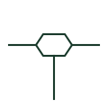

# Cable branch joint

A cable joint where a branch cable is taken off a main cable, drawn as a joint with a third cable leaving it.

[Canonical reference](https://eloragrid.ai/symbols/iec-cable-branch-joint) · [Structured record](../entries/iec-cable-branch-joint.json) · [All references](README.md)

Updated: 2026-10-28. Drawing use: SLD, GA. Reference families: IEC.

Graphical convention: IEC. Branch cable joint.

## What it represents

A branch or tee joint connects a branch cable to a main cable without terminating the main cable at a switchboard. It is common on low voltage street mains and some legacy medium voltage networks, where services or spur cables are taken from the main along its route.
The symbol shows the topology but not the protection of the branch. A branch made by a joint generally has no switching or fault isolation at the tee, so faults on the branch affect the main circuit's protection. Readers should check protection grading and fault level at the branch cable.

## How to read it

- Check how the branch is protected, since there may be no device at the joint.
- Record joint location for fault finding.

## Drawing checklist

- Show the branch cable size and type.
- Confirm protection covers the branch.
- Locate the joint on the route drawing.

## Important distinction

A branch joint connects a third cable mid-route; a one-line bus tap is a connection to a busbar, not a cable.

## Facts

- Graphic cue: Joint mark with a third cable leaving at an angle
- Typical use: LV mains with service branches
- Preview: Original educational illustration; consult the publisher and applicable standard for the exact graphic

## Public references

- [Elastimold underground cable accessories](https://www.abb.com/global/en/areas/electrification/medium-voltage/cable-accessories-connectors/underground/elastimold/underground) — ABB. Manufacturer context for underground cable joints.
- [IEC-60617 symbol preview directory](https://help.autodesk.com/cloudhelp/2021/ENU/AutoCAD-Electrical/files/GUID-7871E6EF-24D5-467E-9B74-321FEDC9DFDA.htm) — Autodesk. Public directory of IEC-oriented symbol families.

## Related references

- [Cable straight-through joint](iec-cable-straight-through-joint.md)
- [One-line bus tap](iec-one-line-bus-tap.md)
- [Power cable joint](ga-cable-joint.md)

Original educational concept geometry, CC BY 4.0. Unitless; not a certified standards glyph or manufacturer footprint.

Elora-authored explanations are CC BY 4.0. Linked standards and manufacturer material retain their own rights. Confirm project requirements using primary sources.
