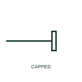

# Sealed cable end

A cable end that is sealed and capped but not connected, such as a spare circuit or a cable laid for future use.

[Canonical reference](https://eloragrid.ai/symbols/iec-cable-end-cap) · [Structured record](../entries/iec-cable-end-cap.json) · [All references](README.md)

Updated: 2026-10-28. Drawing use: SLD, GA. Reference families: IEC.

Graphical convention: IEC. Sealed unterminated cable end.

## What it represents

A sealed cable end shows a cable that terminates without connection, typically capped with a heat-shrink or cold-shrink end cap. It appears on network diagrams for spare circuits, cables laid ahead of future equipment, and cables isolated and left in the ground after a fault or diversion.
A capped cable may still be connected at its other end and therefore energised. The symbol does not tell you its state, so the reader must check the switching position at the source end before treating it as dead. Drawings should also note whether the cable is earthed for safety.

## How to read it

- Check the far end to see whether the cable is energised.
- Look for notes that the capped cable is earthed or isolated.

## Drawing checklist

- Note the energisation state of the capped cable.
- Record its far-end connection.
- Identify planned future use where known.

## Important distinction

A sealed cable end has no connection; a sealing end is a termination connected to equipment or a line.

## Facts

- Graphic cue: Cable line ending in a short bar or cap
- Safety note: May be live from the far end
- Preview: Original educational illustration; consult the publisher and applicable standard for the exact graphic

## Public references

- [Elastimold underground cable accessories](https://www.abb.com/global/en/areas/electrification/medium-voltage/cable-accessories-connectors/underground/elastimold/underground) — ABB. Manufacturer context for cable accessories including end sealing.
- [IEC-60617 symbol preview directory](https://help.autodesk.com/cloudhelp/2021/ENU/AutoCAD-Electrical/files/GUID-7871E6EF-24D5-467E-9B74-321FEDC9DFDA.htm) — Autodesk. Public directory of IEC-oriented symbol families.

## Related references

- [Single-core cable sealing end](iec-single-core-cable-sealing-end.md)
- [Underground cable](iec-underground-cable.md)
- [Earthing switch](earthing-switch.md)

Original educational concept geometry, CC BY 4.0. Unitless; not a certified standards glyph or manufacturer footprint.

Elora-authored explanations are CC BY 4.0. Linked standards and manufacturer material retain their own rights. Confirm project requirements using primary sources.
