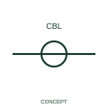

# Cable identification marker

A cable marker identifies a cable association within a schematic conductor group.

[Canonical reference](https://eloragrid.ai/symbols/iec-cable-identification-marker) · [Structured record](../entries/iec-cable-identification-marker.json) · [All references](README.md)

Updated: 2026-10-27. Drawing use: Schematic. Reference families: IEC, Manufacturer.

Graphical convention: IEC. Cable identification marker.

## What it represents

A cable marker identifies a cable association within a schematic conductor group. The cable is an assembly identity shared by its cores, whereas individual wires and terminals have their own identifiers. A cable marker links schematic conductors with the cable schedule.
Keep cable tags, core designations and end connections consistent across the drawing package. A marker placed on one conductor does not imply that the cable contains only one core.

## How to read it

- Coordinate the cable tag, core identity and from/to schedule.
- A cable tag and a wire or core number identify different levels of the wiring arrangement.

## Drawing checklist

- Identify the associated device, circuit or diagram boundary.
- Coordinate the cable tag, core identity and from/to schedule.
- Cross-reference the equipment data, terminal mapping or operating-state legend needed to interpret the form.

## Important distinction

A cable tag and a wire or core number identify different levels of the wiring arrangement.

## Facts

- Reference scope: Specific public IEC-context family form
- Publisher reference token: HW01 (Autodesk token; not a verified IEC database ID)
- Information added: Coordinate the cable tag, core identity and from/to schedule.
- Preview: Independent educational concept; consult the publisher and applicable standard for the exact graphic

## Public references

- [Autodesk IEC-60617 preview: Cable identification and twisted-pair annotation](https://help.autodesk.com/cloudhelp/2021/ENU/AutoCAD-Electrical/files/GUID-37A08C35-43A3-484D-B0EB-0BBCBC4BE709.htm) — Autodesk. Official public publisher family name and reference context; vendor identifiers and graphics are distinct from licensed IEC database content.

## Related references

- [Terminal connection](terminal.md)
- [Busbar](busbar.md)

Original educational concept geometry, CC BY 4.0. Unitless; not a certified standards glyph or manufacturer footprint.

Elora-authored explanations are CC BY 4.0. Linked standards and manufacturer material retain their own rights. Confirm project requirements using primary sources.
