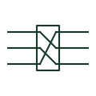

# Cable screen cross-bonding

Screens of three single-core cables transposed at joints so that induced sheath voltages cancel over a major section.

[Canonical reference](https://eloragrid.ai/symbols/iec-cable-screen-cross-bonding) · [Structured record](../entries/iec-cable-screen-cross-bonding.json) · [All references](README.md)

Updated: 2026-10-28. Drawing use: SLD, Schematic. Reference families: IEC.

Graphical convention: IEC. Cross-bonded cable screen arrangement.

## What it represents

On long high voltage single-core circuits, the cable screens are cut at joints and reconnected in rotation so that each screen runs alongside each phase for one third of the section. This cancels most of the induced sheath voltage and circulating current. Bonding diagrams show the screen connections crossing at each joint, with link boxes and sheath voltage limiters.
The symbol shows the topology, not the link box arrangement or sheath voltage limiter rating. Errors in cross-bonding connections cause large circulating currents and overheating, so phase-to-screen allocation at each joint should be read carefully against the cable drawings.

## How to read it

- Check screen rotation order at each joint.
- Locate link boxes and sheath voltage limiters.

## Drawing checklist

- Show screen rotation at each joint.
- Identify link boxes.
- Show solid bonding at section ends.

## Important distinction

Cross-bonding transposes screens between phases; conductor interchange transposes the phase conductors themselves.

## Facts

- Graphic cue: Three screen lines crossing in rotation at joints
- Purpose: Cancel induced sheath voltage and circulating current
- Preview: Original educational illustration; consult the publisher and applicable standard for the exact graphic

## Public references

- [Elastimold underground cable accessories](https://www.abb.com/global/en/areas/electrification/medium-voltage/cable-accessories-connectors/underground/elastimold/underground) — ABB. Manufacturer context for cable joints and accessories.
- [IEC-60617 symbol preview directory](https://help.autodesk.com/cloudhelp/2021/ENU/AutoCAD-Electrical/files/GUID-7871E6EF-24D5-467E-9B74-321FEDC9DFDA.htm) — Autodesk. Public directory of IEC-oriented symbol families.

## Related references

- [Cable straight-through joint](iec-cable-straight-through-joint.md)
- [Interchange of conductors](iec-conductor-interchange.md)
- [Surge arrester](surge-arrester.md)

Original educational concept geometry, CC BY 4.0. Unitless; not a certified standards glyph or manufacturer footprint.

Elora-authored explanations are CC BY 4.0. Linked standards and manufacturer material retain their own rights. Confirm project requirements using primary sources.
