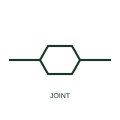

# Cable straight-through joint

A joint connecting two lengths of the same cable in line, drawn as a mark on the cable route.

[Canonical reference](https://eloragrid.ai/symbols/iec-cable-straight-through-joint) · [Structured record](../entries/iec-cable-straight-through-joint.json) · [All references](README.md)

Updated: 2026-10-28. Drawing use: SLD, GA. Reference families: IEC.

Graphical convention: IEC. Straight-through cable joint.

## What it represents

The straight-through joint connects two cable lengths end to end, restoring insulation, screen and sheath continuity. It is shown on cable route drawings and network diagrams at joint bay positions, because joints are the most common failure points on long underground circuits and their locations are needed for fault finding.
The symbol does not show whether screens are cross-bonded at the joint, which is common on high voltage single-core circuits. Cross-bonding links and sheath voltage limiters are separate items on the bonding diagram. It also does not distinguish a joint made between identical cables from one between different types, which is a transition joint.

## How to read it

- Note joint locations for fault-location records.
- Check for screen cross-bonding at the joint.

## Drawing checklist

- Show each joint at its route chainage.
- Identify joint type and kit.
- Reference the screen bonding diagram.

## Important distinction

A straight-through joint links two lengths of the same cable; a branch joint takes off a second cable.

## Facts

- Graphic cue: Bulge or box mark on the cable line
- Field relevance: Joint bays are key fault-location points
- Preview: Original educational illustration; consult the publisher and applicable standard for the exact graphic

## Public references

- [Elastimold underground cable accessories](https://www.abb.com/global/en/areas/electrification/medium-voltage/cable-accessories-connectors/underground/elastimold/underground) — ABB. Manufacturer context for underground cable joints.
- [IEC-60617 symbol preview directory](https://help.autodesk.com/cloudhelp/2021/ENU/AutoCAD-Electrical/files/GUID-7871E6EF-24D5-467E-9B74-321FEDC9DFDA.htm) — Autodesk. Public directory of IEC-oriented symbol families.

## Related references

- [Cable branch joint](iec-cable-branch-joint.md)
- [Cable transition joint](iec-cable-transition-joint.md)
- [Power cable joint](ga-cable-joint.md)

Original educational concept geometry, CC BY 4.0. Unitless; not a certified standards glyph or manufacturer footprint.

Elora-authored explanations are CC BY 4.0. Linked standards and manufacturer material retain their own rights. Confirm project requirements using primary sources.
