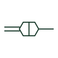

# Cable transition joint

A joint connecting two different cable types, such as paper-insulated to polymeric or land cable to submarine cable.

[Canonical reference](https://eloragrid.ai/symbols/iec-cable-transition-joint) · [Structured record](../entries/iec-cable-transition-joint.json) · [All references](README.md)

Updated: 2026-10-28. Drawing use: SLD, GA. Reference families: IEC.

Graphical convention: IEC. Transition cable joint.

## What it represents

A transition joint joins cables of different construction, for example a legacy paper-insulated lead-sheathed cable to a modern XLPE cable, or a submarine cable to a land cable at a landfall. The drawing distinguishes it from an ordinary joint because the two sides have different ratings, impedances and maintenance requirements.
The symbol does not tell you the rating of each side. The circuit rating is set by the weaker section, so readers should check the cable data on both sides of the transition. Screen and sheath bonding at transitions often changes arrangement and should be read from the bonding diagram.

## How to read it

- Compare cable types and ratings on both sides of the transition.
- Check bonding changes at the transition.

## Drawing checklist

- Identify both cable types at the joint.
- Rate the circuit on the weaker section.
- Show screen and sheath bonding at the transition.

## Important distinction

A transition joint joins dissimilar cables; a straight-through joint joins two lengths of the same type.

## Facts

- Graphic cue: Joint mark with differing line styles either side
- Typical use: Legacy cable replacements and submarine landfalls
- Preview: Original educational illustration; consult the publisher and applicable standard for the exact graphic

## Public references

- [Elastimold underground cable accessories](https://www.abb.com/global/en/areas/electrification/medium-voltage/cable-accessories-connectors/underground/elastimold/underground) — ABB. Manufacturer context for underground cable joints and transitions.
- [IEC-60617 symbol preview directory](https://help.autodesk.com/cloudhelp/2021/ENU/AutoCAD-Electrical/files/GUID-7871E6EF-24D5-467E-9B74-321FEDC9DFDA.htm) — Autodesk. Public directory of IEC-oriented symbol families.

## Related references

- [Cable straight-through joint](iec-cable-straight-through-joint.md)
- [Underwater cable](iec-underwater-cable.md)
- [Power cable joint](ga-cable-joint.md)

Original educational concept geometry, CC BY 4.0. Unitless; not a certified standards glyph or manufacturer footprint.

Elora-authored explanations are CC BY 4.0. Linked standards and manufacturer material retain their own rights. Confirm project requirements using primary sources.
