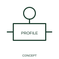

# Cam-profile indication

A cam-profile indication describes the mechanical profile associated with an operating sequence.

[Canonical reference](https://eloragrid.ai/symbols/iec-cam-profile-indication) · [Structured record](../entries/iec-cam-profile-indication.json) · [All references](README.md)

Updated: 2026-10-27. Drawing use: Schematic. Reference families: IEC, Manufacturer.

Graphical convention: IEC. Cam-profile indication.

## What it represents

A cam-profile indication describes the mechanical profile associated with an operating sequence. A profile representation helps describe how a mechanical operating surface relates to the movement it produces. In an electrical diagram its purpose is the operating relationship rather than manufacturing geometry.
Use position or sequence references to link the profile to the operated contacts. Dimensions and machining detail belong in the relevant mechanical documentation.

## How to read it

- Keep profile and position annotations consistent with the operated contacts.
- A profile indication is not a manufacturing drawing of the physical cam.

## Drawing checklist

- Identify the associated device, circuit or diagram boundary.
- Keep profile and position annotations consistent with the operated contacts.
- Cross-reference the equipment data, terminal mapping or operating-state legend needed to interpret the form.

## Important distinction

A profile indication is not a manufacturing drawing of the physical cam.

## Facts

- Reference scope: Specific public IEC-context family form
- Publisher reference token: Q021317 (Autodesk token; not a verified IEC database ID)
- Information added: Keep profile and position annotations consistent with the operated contacts.
- Preview: Independent educational concept; consult the publisher and applicable standard for the exact graphic

## Public references

- [Autodesk IEC-60617 preview: Operating-device and function qualifiers](https://help.autodesk.com/cloudhelp/2021/ENU/AutoCAD-Electrical/files/GUID-3598E18D-9F8A-48CE-83D0-4CEBA0AE869C.htm) — Autodesk. Official public publisher family name and reference context; vendor identifiers and graphics are distinct from licensed IEC database content.

## Related references

- [Relay coil](relay-coil.md)
- [Normally open contact](normally-open-contact.md)

Original educational concept geometry, CC BY 4.0. Unitless; not a certified standards glyph or manufacturer footprint.

Elora-authored explanations are CC BY 4.0. Linked standards and manufacturer material retain their own rights. Confirm project requirements using primary sources.
