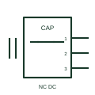

# IEC capacitive proximity sensor: normally closed 3 wire

Capacitive proximity sensor form: Normally Closed 3 Wire.

[Canonical reference](https://eloragrid.ai/symbols/iec-capacitive-proximity-sensor-normally-closed-3-wire) · [Structured record](../entries/iec-capacitive-proximity-sensor-normally-closed-3-wire.json) · [All references](README.md)

Updated: 2026-10-28. Drawing use: Schematic. Reference families: IEC, Manufacturer.

Graphical convention: IEC. Normally Closed 3 Wire.

## What it represents

A capacitive proximity sensor detects a change of capacitance caused by a target entering its sensing field. This entry identifies the normally closed 3 wire form in the publisher's IEC-context family.
A vessel wall or nearby material can change the measured capacitance and indicate a level or presence condition. The normally-closed designation starts with a conducting output or closed contact in the documented reference condition; operation changes that state. The three-wire form distinguishes supply, return and switching output. Confirm sourcing or sinking operation from the actual sensor circuit before connecting it to an input.
Material, mounting, contamination and adjustment affect operation; a capacitive mark does not guarantee detection through every container or medium.

## How to read it

- The normally-closed designation starts with a conducting output or closed contact in the documented reference condition; operation changes that state.
- The three-wire form distinguishes supply, return and switching output. Confirm sourcing or sinking operation from the actual sensor circuit before connecting it to an input.
- Material, mounting, contamination and adjustment affect operation; a capacitive mark does not guarantee detection through every container or medium.

## Drawing checklist

- Identify the target, sensing mode and expected normal condition.
- Label supply, output and connector pins from the actual device diagram.
- Reference output circuit type, operating range and controller input.

## Important distinction

This entry adds the normally closed 3 wire detail to the broader capacitive proximity sensor family. Material, mounting, contamination and adjustment affect operation; a capacitive mark does not guarantee detection through every container or medium.

## Facts

- Drawing form: Normally Closed 3 Wire
- Public vendor block names: HPX12C3 / VPX12C3. Autodesk identifiers, not standards database IDs.
- Drawing purpose: capacitive proximity sensor
- Graphic scope: Independently authored educational illustration; not certified standard geometry, a terminal pinout or a product footprint.

## Public references

- [AutoCAD Electrical: Capacitive proximity switches](https://help.autodesk.com/cloudhelp/2021/ENU/AutoCAD-Electrical/files/GUID-F2CC4639-9203-4C6A-8A9F-2A32717D2BE3.htm) — Autodesk. Public Capacitive Switches table explicitly lists HPX12C3 / VPX12C3 with this operating or connection form. Vendor graphics are linked, not copied.

## Related references

- [Capacitive proximity switch](capacitive-proximity-switch.md)
- [PLC digital input](plc-digital-input.md)
- [Terminal connection](terminal.md)

Original educational concept geometry, CC BY 4.0. Unitless; not a certified standards glyph or manufacturer footprint.

Elora-authored explanations are CC BY 4.0. Linked standards and manufacturer material retain their own rights. Confirm project requirements using primary sources.
