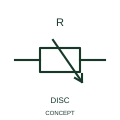

# Carbon-disc variable resistor

This representation identifies the publisher's carbon-disc variable-resistance form.

[Canonical reference](https://eloragrid.ai/symbols/iec-carbon-disc-variable-resistor) · [Structured record](../entries/iec-carbon-disc-variable-resistor.json) · [All references](README.md)

Updated: 2026-10-27. Drawing use: Schematic. Reference families: IEC, Manufacturer.

Graphical convention: IEC. Carbon-disc variable resistor.

## What it represents

This representation identifies the publisher's carbon-disc variable-resistance form. The publisher identifies a variable resistive form using carbon discs as part of its operating construction. That identifies a component principle without assigning a resistance law or power rating.
Document the actual control mechanism and terminal arrangement where the device appears in a legacy circuit. It should not be silently replaced with a potentiometer having a different connection and operating behaviour.

## How to read it

- State the resistance-control mechanism and associated terminals in the equipment description.
- The material/mechanism indication is distinct from a generic electronic potentiometer.

## Drawing checklist

- Identify the associated device, circuit or diagram boundary.
- State the resistance-control mechanism and associated terminals in the equipment description.
- Cross-reference the equipment data, terminal mapping or operating-state legend needed to interpret the form.

## Important distinction

The material/mechanism indication is distinct from a generic electronic potentiometer.

## Facts

- Reference scope: Specific public IEC-context family form
- Publisher reference token: HVR1R8 (Autodesk token; not a verified IEC database ID)
- Information added: State the resistance-control mechanism and associated terminals in the equipment description.
- Preview: Independent educational concept; consult the publisher and applicable standard for the exact graphic

## Public references

- [Resistors and heater-element symbols](https://help.autodesk.com/cloudhelp/2021/ENU/AutoCAD-Electrical/files/GUID-1D071951-D38E-4B15-8B9E-C30ECBD55C19.htm) — Autodesk. Official public publisher family name and reference context; vendor identifiers and graphics are distinct from licensed IEC database content.

## Related references

- [Resistor](resistor.md)
- [Capacitor](capacitor.md)

Original educational concept geometry, CC BY 4.0. Unitless; not a certified standards glyph or manufacturer footprint.

Elora-authored explanations are CC BY 4.0. Linked standards and manufacturer material retain their own rights. Confirm project requirements using primary sources.
