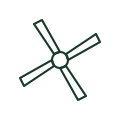

# Ceiling fan plan mark

Plan mark for a ceiling sweep fan, showing blade positions around a central outlet.

[Canonical reference](https://eloragrid.ai/symbols/iec-ceiling-fan-plan-mark) · [Structured record](../entries/iec-ceiling-fan-plan-mark.json) · [All references](README.md)

Updated: 2026-10-28. Drawing use: GA. Reference families: IEC.

Graphical convention: IEC. Ceiling fan.

## What it represents

Ceiling fans are drawn on lighting plans as a central circle with blades radiating out, sometimes combined with a light symbol where a light kit is fitted. The form tells the installer to provide a fan-rated support at the ceiling and a controller at the wall.
The plan should also show the controller, which may be a speed controller, a combined fan-light switch or a remote receiver. Clearance from walls and from luminaires is a common coordination check. The mark does not state the sweep diameter or motor rating. These come from the fixture schedule.

## How to read it

- Check the support requirement for the fan weight and torque.
- Locate the controller.

## Drawing checklist

- State sweep diameter.
- Show controller location.
- Note any integral light.

## Important distinction

An extract fan moves air out of a room; a ceiling sweep fan circulates air within it.

## Facts

- Graphic form: Centre circle with radiating blades
- Companion device: Speed controller
- Exact standard graphic: Not reproduced here; confirm the form against IEC 60617 and the project legend

## Public references

- [IEC graphical symbols for diagrams](https://tc3.iec.ch/tc-activity/graphical-symbols-for-diagrams/) — IEC. IEC graphical symbol context; independently drawn here.
- [Electrical installation design methodology and references](https://www.electrical-installation.org/enwiki/General_rules_of_electrical_installation_design) — Schneider Electric — Electrical Installation Guide. Design methodology for fixed loads in final circuits.

## Related references

- [Single-phase motor with fan](single-phase-motor-with-fan.md)
- [Extract fan plan mark](iec-extract-fan-plan-mark.md)
- [Luminaire general plan symbol](iec-luminaire-general-plan-symbol.md)

Original educational concept geometry, CC BY 4.0. Unitless; not a certified standards glyph or manufacturer footprint.

Elora-authored explanations are CC BY 4.0. Linked standards and manufacturer material retain their own rights. Confirm project requirements using primary sources.
