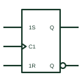

# IEC clocked SR flip-flop

IEC bistable with 1S and 1R inputs that act only under C1 control, giving a synchronous set-reset function.

[Canonical reference](https://eloragrid.ai/symbols/iec-clocked-sr-flip-flop) · [Structured record](../entries/iec-clocked-sr-flip-flop.json) · [All references](README.md)

Updated: 2026-10-28. Drawing use: Schematic. Reference families: IEC, Manufacturer.

Graphical convention: IEC. Rectangular bistable with 1S, 1R and C1 inputs.

## What it represents

Adding the C1 prefix to S and R makes them synchronous: they act only when C1 is active or on its active transition. The element therefore combines set-reset storage with clocking, which keeps state changes aligned with the rest of a synchronous system.
Clocked SR elements appear in function-block diagrams for PLCs and in state-machine documentation. On hardware schematics the same function is often implemented with a JK or D flip-flop and gating, so cross-reference the implementation.
The symbol needs a stated rule for 1S and 1R active together. Without S or R dependency or a note, that condition is undefined.

## How to read it

- Prefix numbers on S and R show they are synchronous.
- Look for a priority statement for both inputs active.

## Drawing checklist

- Label 1S and 1R inside the outline.
- Mark C1 dynamic if edge-triggered.
- State set or reset priority.

## Important distinction

The unclocked IEC SR latch acts immediately on S and R.

## Facts

- Key labels: 1S, 1R, C1
- Behaviour: Synchronous set and reset
- Artwork scope: Original educational illustration; consult the applicable standard and the selected device documentation for the exact graphic

## Public references

- [Overview of IEEE Standard 91-1984: explanation of logic symbols (SDYZ001A)](https://www.ti.com/lit/ml/sdyz001a/sdyz001a.pdf) — Texas Instruments. C dependency applied to S and R inputs on bistable elements.

## Related references

- [IEC SR latch (rectangular form)](iec-sr-latch.md)
- [IEC set and reset dependency (S, R)](iec-set-reset-dependency.md)
- [IEC control dependency (C)](iec-control-dependency-c.md)

Original educational concept geometry, CC BY 4.0. Unitless; not a certified standards glyph or manufacturer footprint.

Elora-authored explanations are CC BY 4.0. Linked standards and manufacturer material retain their own rights. Confirm project requirements using primary sources.
