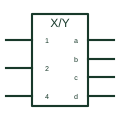

# IEC general code converter (X/Y)

IEC element marked X/Y, the general coder converting one code, named X, into another, named Y.

[Canonical reference](https://eloragrid.ai/symbols/iec-code-converter) · [Structured record](../entries/iec-code-converter.json) · [All references](README.md)

Updated: 2026-10-28. Drawing use: Schematic. Reference families: IEC, Manufacturer.

Graphical convention: IEC. Rectangular element with X/Y qualifier where X and Y name the codes.

## What it represents

The general coder qualifier X/Y is replaced on a real symbol by the names of the input and output codes, such as BIN/GRAY or DEC/BCD. Where the codes are not standard, inputs and outputs carry numbers and a table on the drawing gives the relationship. TI's overview also shows coders embedded in larger symbols to produce affecting inputs for dependency notation.
On control and protection logic drawings, a code converter may represent a lookup in a PLC or a hardware coder converting a selector position code into commands. Including the conversion table is essential because the X/Y label alone does not define the mapping for non-standard codes.
The element does not state propagation timing or behaviour for invalid input codes. State those in notes where they matter.

## How to read it

- Replace X and Y with code names on a real symbol.
- Look for a conversion table on the sheet.

## Drawing checklist

- Name both codes or provide a table.
- Number inputs and outputs consistently with the table.
- State behaviour for invalid codes.

## Important distinction

Specific coders such as BIN/OCT or BCD/7SEG are instances of this general form with standard code names.

## Facts

- Qualifier: X/Y
- Non-standard codes: Require a conversion table
- Artwork scope: Original educational illustration; consult the applicable standard and the selected device documentation for the exact graphic

## Public references

- [Overview of IEEE Standard 91-1984: explanation of logic symbols (SDYZ001A)](https://www.ti.com/lit/ml/sdyz001a/sdyz001a.pdf) — Texas Instruments. General coder qualifier and use of a coder to produce affecting inputs.

## Related references

- [IEC binary decoder (X/Y coder)](iec-binary-decoder.md)
- [IEC BCD-to-seven-segment decoder](iec-bcd-to-seven-segment-decoder.md)
- [IEC priority encoder (HPRI/BIN)](iec-priority-encoder.md)

Original educational concept geometry, CC BY 4.0. Unitless; not a certified standards glyph or manufacturer footprint.

Elora-authored explanations are CC BY 4.0. Linked standards and manufacturer material retain their own rights. Confirm project requirements using primary sources.
