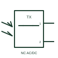

# IEC combined photoelectric sensor: normally closed emitter-receiver AC/DC driven 2 pin

Combined photoelectric sensor form: Normally Closed Emitter-Receiver AC/DC Driven 2 PIN.

[Canonical reference](https://eloragrid.ai/symbols/iec-combined-photoelectric-sensor-normally-closed-emitter-receiver-ac-dc-driven-2-pin) · [Structured record](../entries/iec-combined-photoelectric-sensor-normally-closed-emitter-receiver-ac-dc-driven-2-pin.json) · [All references](README.md)

Updated: 2026-10-28. Drawing use: Schematic. Reference families: IEC, Manufacturer.

Graphical convention: IEC. Normally Closed Emitter-Receiver AC/DC Driven 2 PIN.

## What it represents

A combined photoelectric sensor contains an emitter and a receiver within the same documented sensing unit. This entry identifies the normally closed emitter-receiver ac/dc driven 2 pin form in the publisher's IEC-context family.
A reflective sensing arrangement can detect a passing object or a change in returned light and send the result to a control input. The normally-closed designation starts with a conducting output or closed contact in the documented reference condition; operation changes that state. The two-connection interface must be read with the load and supply arrangement. Leakage current and minimum load can matter where a powered device is connected in series with an input.
The publisher identifies an AC/DC supply form. Its permissible voltage range and the connected input still need to match the selected equipment. The combined housing does not establish whether a reflector or the target returns the light. Sensing mode, light-on or dark-on selection and pin functions need the selected product diagram.

## How to read it

- The normally-closed designation starts with a conducting output or closed contact in the documented reference condition; operation changes that state.
- The two-connection interface must be read with the load and supply arrangement. Leakage current and minimum load can matter where a powered device is connected in series with an input.
- The publisher identifies an AC/DC supply form. Its permissible voltage range and the connected input still need to match the selected equipment.
- The combined housing does not establish whether a reflector or the target returns the light. Sensing mode, light-on or dark-on selection and pin functions need the selected product diagram.

## Drawing checklist

- Identify the target, sensing mode and expected normal condition.
- Label supply, output and connector pins from the actual device diagram.
- Reference output circuit type, operating range and controller input.

## Important distinction

This entry adds the normally closed emitter-receiver ac/dc driven 2 pin detail to the broader combined photoelectric sensor family. The combined housing does not establish whether a reflector or the target returns the light. Sensing mode, light-on or dark-on selection and pin functions need the selected product diagram.

## Facts

- Drawing form: Normally Closed Emitter-Receiver AC/DC Driven 2 PIN
- Public vendor block names: HPE12B22 / VPE12B22. Autodesk identifiers, not standards database IDs.
- Drawing purpose: combined photoelectric sensor
- Graphic scope: Independently authored educational illustration; not certified standard geometry, a terminal pinout or a product footprint.

## Public references

- [AutoCAD Electrical: Photoelectric emitter/receiver switches](https://help.autodesk.com/cloudhelp/2021/ENU/AutoCAD-Electrical/files/GUID-15ABE47A-723F-4004-BF2A-9CC285DE7882.htm) — Autodesk. Public Photoelectric Emitter/Receiver Switches table explicitly lists HPE12B22 / VPE12B22 with this operating or connection form. Vendor graphics are linked, not copied.

## Related references

- [Photoelectric emitter-receiver switch](photoelectric-emitter-receiver-switch.md)
- [PLC digital input](plc-digital-input.md)
- [Terminal connection](terminal.md)

Original educational concept geometry, CC BY 4.0. Unitless; not a certified standards glyph or manufacturer footprint.

Elora-authored explanations are CC BY 4.0. Linked standards and manufacturer material retain their own rights. Confirm project requirements using primary sources.
