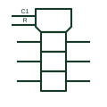

# IEC common-control block

Notched block above an array; its inputs apply to every element below unless dependency notation limits them.

[Canonical reference](https://eloragrid.ai/symbols/iec-common-control-block) · [Structured record](../entries/iec-common-control-block.json) · [All references](README.md)

Updated: 2026-10-28. Drawing use: Schematic. Reference families: IEC, Manufacturer.

Graphical convention: IEC. Notched block above an array of elements.

## What it represents

TI's overview of IEEE Std 91 describes the common-control block as the only distinctively shaped outline used in the IEC system. It sits above an array of elements, and an input to it is an input to every element below unless dependency notation states otherwise. Clocks, clears and enables of multi-bit registers are typically drawn here.
When reading a register or latch symbol, start with the common-control block: it shows which signals act on all bits. The elements below then show only the per-bit data inputs and outputs, which keeps an octal device readable on one sheet.
The block itself does not define a function; the labels and dependency numbers on its inputs do. Without those labels it is not possible to tell whether an input is a clock, an enable or a mode control.

## How to read it

- Read the control block first, then the per-bit elements.
- Dependency numbers decide which bits each control affects.

## Drawing checklist

- Draw the notched shape distinct from ordinary elements.
- Label each control input with its function and dependency number.
- Show only per-bit signals on the elements below.

## Important distinction

The common-output element has a double line and collects outputs below an array.

## Facts

- Outline: Notched block, unique in the IEC system
- Typical inputs: Clock, clear, enable
- Artwork scope: Original educational illustration; consult the applicable standard and the selected device documentation for the exact graphic

## Public references

- [Overview of IEEE Standard 91-1984: explanation of logic symbols (SDYZ001A)](https://www.ti.com/lit/ml/sdyz001a/sdyz001a.pdf) — Texas Instruments. Describes the common-control block and how its inputs apply to the array.

## Related references

- [IEC common-output element](iec-common-output-element.md)
- [IEC shift register (SRGm)](iec-shift-register.md)
- [Transparent D latch](transparent-d-latch.md)

Original educational concept geometry, CC BY 4.0. Unitless; not a certified standards glyph or manufacturer footprint.

Elora-authored explanations are CC BY 4.0. Linked standards and manufacturer material retain their own rights. Confirm project requirements using primary sources.
