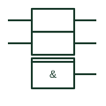

# IEC common-output element

Element with a double top line that produces one output depending on all elements of an array above it.

[Canonical reference](https://eloragrid.ai/symbols/iec-common-output-element) · [Structured record](../entries/iec-common-output-element.json) · [All references](README.md)

Updated: 2026-10-28. Drawing use: Schematic. Reference families: IEC, Manufacturer.

Graphical convention: IEC. Element below an array with a double line at its top, carrying a general qualifier.

## What it represents

TI's public overview of IEEE Std 91 describes the common-output element as having a double line at its top. It sits beneath an array of identical elements and produces a single output that depends on all of them, such as a combined carry or an all-equal flag. It must carry its own general qualifier to say what function it performs.
On data-book style drawings the common-output element saves repeating a gate for every bit. When reading it, look at the qualifier in the element (for example & or ≥1) and remember that its inputs come from each element above as well as any external inputs drawn on its side.
The double line only signals the structural role. Without the qualifier inside, the function is undefined, and the drawing should not be accepted in that state.

## How to read it

- Look for the qualifier inside the double-line element; it defines the function.
- Inputs come from every element in the array above.

## Drawing checklist

- Draw the double line clearly at the top of the element.
- Include a general qualifier.
- Show any additional external inputs on the side.

## Important distinction

The common-control block has a notched outline at the top of an array and distributes inputs downwards; the common-output element collects results at the bottom.

## Facts

- Distinctive feature: Double line at the top edge
- Requirement: Must carry a general qualifier
- Artwork scope: Original educational illustration; consult the applicable standard and the selected device documentation for the exact graphic

## Public references

- [Overview of IEEE Standard 91-1984: explanation of logic symbols (SDYZ001A)](https://www.ti.com/lit/ml/sdyz001a/sdyz001a.pdf) — Texas Instruments. Describes the common-output element and its double-line feature.

## Related references

- [IEC common-control block](iec-common-control-block.md)
- [IEC AND gate (rectangular form)](iec-and-gate.md)
- [Digital magnitude comparator](digital-magnitude-comparator.md)

Original educational concept geometry, CC BY 4.0. Unitless; not a certified standards glyph or manufacturer footprint.

Elora-authored explanations are CC BY 4.0. Linked standards and manufacturer material retain their own rights. Confirm project requirements using primary sources.
