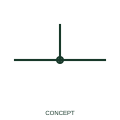

# Conductor connection junction

A junction indication marks a documented electrical connection between conductor branches.

[Canonical reference](https://eloragrid.ai/symbols/iec-conductor-connection-junction) · [Structured record](../entries/iec-conductor-connection-junction.json) · [All references](README.md)

Updated: 2026-10-27. Drawing use: Schematic. Reference families: Manufacturer.

## What it represents

A junction indication marks a documented electrical connection between conductor branches. The junction is a drawing connectivity statement: the branches belong to one connected electrical network at that point. It is different from a hardware splice which may have its own material and installation record.
Apply the drawing legend’s junction convention consistently and check the CAD connection data. Visual line overlap is not sufficient evidence that an automatic wire report will treat the lines as connected.

## How to read it

- Check the connection mark and CAD connectivity at every branch rather than inferring connection from line proximity.
- A crossing line is not necessarily a connected conductor.

## Drawing checklist

- Identify the associated device, circuit or diagram boundary.
- Check the connection mark and CAD connectivity at every branch rather than inferring connection from line proximity.
- Cross-reference the equipment data, terminal mapping or operating-state legend needed to interpret the form.

## Important distinction

A crossing line is not necessarily a connected conductor.

## Facts

- Reference scope: Publisher drafting annotation / connectivity convention
- Documentation scope: Wire insertion and connectivity behaviour; no publisher block identifier or IEC database ID is asserted.
- Information added: Check the connection mark and CAD connectivity at every branch rather than inferring connection from line proximity.
- Preview: Independent educational concept; consult the publisher and applicable standard for the exact graphic

## Public references

- [Wire connection dots, crossing gaps and loops](https://help.autodesk.com/cloudhelp/2020/ENU/AutoCAD-Electrical/files/GUID-936BB8A9-9C01-4AC6-B833-CB97700A7203.htm) — Autodesk. Official public publisher family name and reference context; vendor identifiers and graphics are distinct from licensed IEC database content.

## Related references

- [Terminal connection](terminal.md)
- [Busbar](busbar.md)

Original educational concept geometry, CC BY 4.0. Unitless; not a certified standards glyph or manufacturer footprint.

Elora-authored explanations are CC BY 4.0. Linked standards and manufacturer material retain their own rights. Confirm project requirements using primary sources.
