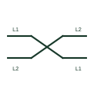

# Interchange of conductors

A crossing mark showing that two or more conductors swap position, such as a phase transposition or deliberate phase swap.

[Canonical reference](https://eloragrid.ai/symbols/iec-conductor-interchange) · [Structured record](../entries/iec-conductor-interchange.json) · [All references](README.md)

Updated: 2026-10-28. Drawing use: SLD, Schematic. Reference families: IEC.

Graphical convention: IEC. Conductor interchange form.

## What it represents

The interchange form shows conductors crossing over so that their positions change along the run. On transmission lines it represents transposition, used to balance phase impedances. On motor and generator circuits it may show a deliberate swap of two phases to reverse rotation or to correct phase sequence.
The symbol must be read with the phase labels on both sides, because the purpose differs. An unlabelled crossing may be mistaken for a drafting artefact. Where the interchange changes phase sequence, any synchronising or phase-sequence-sensitive equipment downstream must be checked.

## How to read it

- Read phase labels either side of the interchange.
- Check whether rotation or phase sequence downstream depends on it.

## Drawing checklist

- Label phases on both sides of the interchange.
- State the reason for the swap where it changes rotation.
- Check synchronising and metering connections downstream.

## Important distinction

Interchanged conductors change position or phase; an unconnected crossing just passes over another conductor with no change.

## Facts

- Graphic cue: Two conductor lines crossing to swap positions
- Typical use: Line transposition and rotation reversal
- Preview: Original educational illustration; consult the publisher and applicable standard for the exact graphic

## Public references

- [Wire connection dots, crossing gaps and loops](https://help.autodesk.com/cloudhelp/2020/ENU/AutoCAD-Electrical/files/GUID-936BB8A9-9C01-4AC6-B833-CB97700A7203.htm) — Autodesk. Public guidance on wire crossings and connection display in drawings.
- [IEC-60617 symbol preview directory](https://help.autodesk.com/cloudhelp/2021/ENU/AutoCAD-Electrical/files/GUID-7871E6EF-24D5-467E-9B74-321FEDC9DFDA.htm) — Autodesk. Public directory of IEC-oriented symbol families.

## Related references

- [Unconnected conductor crossing](iec-unconnected-conductor-crossing.md)
- [Three-phase conductor group](iec-three-phase-conductor-group.md)
- [Synchronism check](25-synchronism-check.md)

Original educational concept geometry, CC BY 4.0. Unitless; not a certified standards glyph or manufacturer footprint.

Elora-authored explanations are CC BY 4.0. Linked standards and manufacturer material retain their own rights. Confirm project requirements using primary sources.
