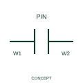

# Connector changing wire identity

This form identifies a connector representation that allows wire-number identities to change across the interface.

[Canonical reference](https://eloragrid.ai/symbols/iec-connector-changing-wire-identity) · [Structured record](../entries/iec-connector-changing-wire-identity.json) · [All references](README.md)

Updated: 2026-10-27. Drawing use: Schematic. Reference families: IEC, Manufacturer.

Graphical convention: IEC. Connector changing wire identity.

## What it represents

This form identifies a connector representation that allows wire-number identities to change across the interface. The two sides retain their separate wire identifiers while the connector pin mapping shows how they connect. That numbering rule does not create a conversion or an isolated electrical function.
Record both wire labels at the correct pin identities. The mating connector relationship is the evidence of continuity across the numbering change.

## How to read it

- Keep both wire identifiers tied to the correct mating pins.
- A change in wire number does not by itself indicate electrical isolation, conversion or a change in voltage.

## Drawing checklist

- Identify the associated device, circuit or diagram boundary.
- Keep both wire identifiers tied to the correct mating pins.
- Cross-reference the equipment data, terminal mapping or operating-state legend needed to interpret the form.

## Important distinction

A change in wire number does not by itself indicate electrical isolation, conversion or a change in voltage.

## Facts

- Reference scope: Specific public IEC-context family form
- Publisher reference token: HCN1PJ (Autodesk token; not a verified IEC database ID)
- Information added: Keep both wire identifiers tied to the correct mating pins.
- Preview: Independent educational concept; consult the publisher and applicable standard for the exact graphic

## Public references

- [Autodesk IEC-60617 preview: Connector forms that change wire numbers](https://help.autodesk.com/cloudhelp/2021/ENU/AutoCAD-Electrical/files/GUID-DA27EF75-79E8-43E5-A07C-E19CD7738C5C.htm) — Autodesk. Official public publisher family name and reference context; vendor identifiers and graphics are distinct from licensed IEC database content.

## Related references

- [Terminal connection](terminal.md)
- [Busbar](busbar.md)

Original educational concept geometry, CC BY 4.0. Unitless; not a certified standards glyph or manufacturer footprint.

Elora-authored explanations are CC BY 4.0. Linked standards and manufacturer material retain their own rights. Confirm project requirements using primary sources.
