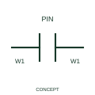

# Connector retaining wire identity

This form identifies a separable connector whose publisher representation preserves wire-number identity across the interface.

[Canonical reference](https://eloragrid.ai/symbols/iec-connector-retaining-wire-identity) · [Structured record](../entries/iec-connector-retaining-wire-identity.json) · [All references](README.md)

Updated: 2026-10-27. Drawing use: Schematic. Reference families: IEC, Manufacturer.

Graphical convention: IEC. Connector retaining wire identity.

## What it represents

This form identifies a separable connector whose publisher representation preserves wire-number identity across the interface. The electrical connection passes through mating connector pins while the drafting system retains the wire identifier. Connector tags and pin numbers still describe the separable interface.
Use the pin mapping to link both sides and retain connector identity even where wire labels match. A wiring report should not erase the physical connector simply because the number is continuous.

## How to read it

- Document connector and pin tags independently of the continuous wire identifier.
- Wire-number continuity is a drafting-data convention and does not eliminate the connector's separable physical interface.

## Drawing checklist

- Identify the associated device, circuit or diagram boundary.
- Document connector and pin tags independently of the continuous wire identifier.
- Cross-reference the equipment data, terminal mapping or operating-state legend needed to interpret the form.

## Important distinction

Wire-number continuity is a drafting-data convention and does not eliminate the connector's separable physical interface.

## Facts

- Reference scope: Specific public IEC-context family form
- Publisher reference token: HC01PJ, HC01PJ1 (Autodesk token; not a verified IEC database ID)
- Information added: Document connector and pin tags independently of the continuous wire identifier.
- Preview: Independent educational concept; consult the publisher and applicable standard for the exact graphic

## Public references

- [AutoCAD Electrical: Connectors](https://help.autodesk.com/cloudhelp/2021/ENU/AutoCAD-Electrical/files/GUID-7175D293-9F4C-485C-8E2D-DE684820D53B.htm) — Autodesk. Official public publisher family name and reference context; vendor identifiers and graphics are distinct from licensed IEC database content.

## Related references

- [Terminal connection](terminal.md)
- [Busbar](busbar.md)

Original educational concept geometry, CC BY 4.0. Unitless; not a certified standards glyph or manufacturer footprint.

Elora-authored explanations are CC BY 4.0. Linked standards and manufacturer material retain their own rights. Confirm project requirements using primary sources.
