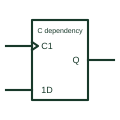

# IEC control dependency (C)

Dependency label Cm on a clock or control input; inputs prefixed with m act only when Cm is active.

[Canonical reference](https://eloragrid.ai/symbols/iec-control-dependency-c) · [Structured record](../entries/iec-control-dependency-c.json) · [All references](README.md)

Updated: 2026-10-28. Drawing use: Schematic. Reference families: IEC, Manufacturer.

Graphical convention: IEC. Control input labelled Cm with affected data inputs labelled mD, mJ, mK and similar.

## What it represents

C dependency identifies a control input, usually a clock, and the inputs it controls. Data inputs labelled 1D, 1J or 1S act only when C1 is at its internal 1 state, or on its active transition if C1 has a dynamic mark. TI's overview notes that synchronous inputs are recognisable by these dependency prefixes.
Reading C dependency correctly is the key to understanding flip-flops, latches, registers and counters drawn in IEC form. Inputs without the prefix, such as a plain R, are asynchronous and act regardless of the clock.
The label does not tell you setup and hold times or clock frequency limits. Those remain device data. Trace each prefixed data input to the numbered control before deciding whether it can change the stored state asynchronously.

## How to read it

- Inputs with the C number as prefix are synchronous.
- Inputs without the prefix are asynchronous overrides.

## Drawing checklist

- Label clock inputs as Cm.
- Prefix synchronous inputs with m.
- Mark the clock input dynamic where edge-triggered.

## Important distinction

EN acts on outputs; C dependency acts on inputs.

## Facts

- Affecting input at 1: Permits action
- Affecting input at 0: Prevents action
- Artwork scope: Original educational illustration; consult the applicable standard and the selected device documentation for the exact graphic

## Public references

- [Overview of IEEE Standard 91-1984: explanation of logic symbols (SDYZ001A)](https://www.ti.com/lit/ml/sdyz001a/sdyz001a.pdf) — Texas Instruments. C (control) dependency and use with storage elements.

## Related references

- [IEC D flip-flop (rectangular form)](iec-d-flip-flop.md)
- [IEC transparent D latch (rectangular form)](iec-d-latch.md)
- [IEC dynamic input (edge-triggered)](iec-dynamic-input.md)

Original educational concept geometry, CC BY 4.0. Unitless; not a certified standards glyph or manufacturer footprint.

Elora-authored explanations are CC BY 4.0. Linked standards and manufacturer material retain their own rights. Confirm project requirements using primary sources.
