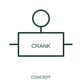

# Crank-operation qualifier

This qualifier identifies manual operation through a crank mechanism.

[Canonical reference](https://eloragrid.ai/symbols/iec-crank-operation-qualifier) · [Structured record](../entries/iec-crank-operation-qualifier.json) · [All references](README.md)

Updated: 2026-10-27. Drawing use: Schematic. Reference families: IEC, Manufacturer.

Graphical convention: IEC. Crank-operation qualifier.

## What it represents

This qualifier identifies manual operation through a crank mechanism. A crank supplies manual mechanical movement to a mechanism that may require several turns or a particular travel. Its role is different from a momentary electrical command to a motor drive.
The schematic records the operating method; the equipment instructions describe actual travel and operating procedure. Indicate any separate position switch rather than assuming the crank mark includes feedback.

## How to read it

- Document the mechanism being moved and its travel or operating positions.
- A crank-operated mechanism is not automatically a motor-driven mechanism.

## Drawing checklist

- Identify the associated device, circuit or diagram boundary.
- Document the mechanism being moved and its travel or operating positions.
- Cross-reference the equipment data, terminal mapping or operating-state legend needed to interpret the form.

## Important distinction

A crank-operated mechanism is not automatically a motor-driven mechanism.

## Facts

- Reference scope: Specific public IEC-context family form
- Publisher reference token: Q021214 (Autodesk token; not a verified IEC database ID)
- Information added: Document the mechanism being moved and its travel or operating positions.
- Preview: Independent educational concept; consult the publisher and applicable standard for the exact graphic

## Public references

- [Autodesk IEC-60617 preview: Operating-device and function qualifiers](https://help.autodesk.com/cloudhelp/2021/ENU/AutoCAD-Electrical/files/GUID-3598E18D-9F8A-48CE-83D0-4CEBA0AE869C.htm) — Autodesk. Official public publisher family name and reference context; vendor identifiers and graphics are distinct from licensed IEC database content.

## Related references

- [Relay coil](relay-coil.md)
- [Normally open contact](normally-open-contact.md)

Original educational concept geometry, CC BY 4.0. Unitless; not a certified standards glyph or manufacturer footprint.

Elora-authored explanations are CC BY 4.0. Linked standards and manufacturer material retain their own rights. Confirm project requirements using primary sources.
