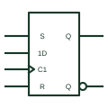

# IEC D flip-flop (rectangular form)

IEC bistable with a dynamic C1 clock and a 1D data input, storing D on the active clock edge.

[Canonical reference](https://eloragrid.ai/symbols/iec-d-flip-flop) · [Structured record](../entries/iec-d-flip-flop.json) · [All references](README.md)

Updated: 2026-10-28. Drawing use: Schematic. Reference families: IEC, Manufacturer.

Graphical convention: IEC. Rectangular bistable with dynamic C1 input and 1D data input.

## What it represents

In IEC form the D flip-flop is an unlabelled bistable outline with a clock input labelled C1 carrying the dynamic wedge, and a data input labelled 1D to show it is controlled by C1. Asynchronous set and reset inputs are labelled S and R without a number. The two outputs are Q and its complement shown with a negation or polarity mark.
TI's overview stresses that a D input always sets the storage element to 1 at its internal 1 state and resets it at 0. On sequential drawings this form makes clocking explicit: anything without the 1 prefix acts immediately, regardless of the clock.
The symbol does not state setup, hold or propagation times, and does not define the power-up state unless an I=0 or I=1 qualifier is added.

## How to read it

- The wedge on C1 indicates edge triggering.
- S and R without numbers are asynchronous.

## Drawing checklist

- Label the clock C1 with a dynamic mark.
- Prefix the data input with 1.
- Add I=0 or I=1 where power-up state matters.

## Important distinction

The IEC D latch has a C1 input without a dynamic mark and is transparent while C1 is active.

## Facts

- Key labels: C1 (dynamic), 1D, S, R
- Outputs: Q and complemented Q
- Artwork scope: Original educational illustration; consult the applicable standard and the selected device documentation for the exact graphic

## Public references

- [Overview of IEEE Standard 91-1984: explanation of logic symbols (SDYZ001A)](https://www.ti.com/lit/ml/sdyz001a/sdyz001a.pdf) — Texas Instruments. Bistable element forms and C dependency with D inputs.
- [SN74HC74 — positive-edge D flip-flops](https://www.ti.com/lit/ds/symlink/sn74hc74.pdf) — Texas Instruments. D flip-flop device documentation.

## Related references

- [Positive-edge D flip-flop](positive-edge-d-flip-flop.md)
- [IEC transparent D latch (rectangular form)](iec-d-latch.md)
- [IEC control dependency (C)](iec-control-dependency-c.md)

Original educational concept geometry, CC BY 4.0. Unitless; not a certified standards glyph or manufacturer footprint.

Elora-authored explanations are CC BY 4.0. Linked standards and manufacturer material retain their own rights. Confirm project requirements using primary sources.
