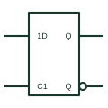

# IEC transparent D latch (rectangular form)

IEC bistable with a static C1 control and 1D input; the output follows D while C1 is active.

[Canonical reference](https://eloragrid.ai/symbols/iec-d-latch) · [Structured record](../entries/iec-d-latch.json) · [All references](README.md)

Updated: 2026-10-28. Drawing use: Schematic. Reference families: IEC, Manufacturer.

Graphical convention: IEC. Rectangular bistable with static C1 and 1D inputs.

## What it represents

The transparent latch is drawn like the D flip-flop but the C1 input has no dynamic wedge. While C1 is at its internal 1 state, the output follows the 1D input; when C1 returns to 0 the last value is held. TI's overview describes this as a level-operated control input.
Latches are used to capture data from a bus or to hold a value for a display or relay driver. In octal devices the common-control block carries C1 and the output enable, with eight per-bit elements below.
Because the output follows the input during the active level, glitches on D during that time pass through. The symbol shows this behaviour only through the absence of the wedge, so check it carefully.

## How to read it

- No wedge on C1 means level-sensitive.
- In octal parts, look for C1 in the common-control block.

## Drawing checklist

- Draw C1 without a dynamic mark.
- Prefix the data input with 1.
- Show output enable separately if present.

## Important distinction

The IEC D flip-flop has a dynamic wedge on C1 and captures only at the edge.

## Facts

- Clock type: Level-operated
- Key labels: C1, 1D
- Artwork scope: Original educational illustration; consult the applicable standard and the selected device documentation for the exact graphic

## Public references

- [Overview of IEEE Standard 91-1984: explanation of logic symbols (SDYZ001A)](https://www.ti.com/lit/ml/sdyz001a/sdyz001a.pdf) — Texas Instruments. Transparent latch behaviour with level-operated control input.
- [SN74HC373 — transparent D latches](https://www.ti.com/lit/ds/symlink/sn74hc373.pdf) — Texas Instruments. Transparent latch documentation.

## Related references

- [Transparent D latch](transparent-d-latch.md)
- [IEC D flip-flop (rectangular form)](iec-d-flip-flop.md)
- [IEC common-control block](iec-common-control-block.md)

Original educational concept geometry, CC BY 4.0. Unitless; not a certified standards glyph or manufacturer footprint.

Elora-authored explanations are CC BY 4.0. Linked standards and manufacturer material retain their own rights. Confirm project requirements using primary sources.
