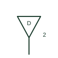

# Data outlet plan symbol

Plan symbol for a structured-cabling data outlet, usually tagged with the number of ports and outlet ID.

[Canonical reference](https://eloragrid.ai/symbols/iec-data-outlet) · [Structured record](../entries/iec-data-outlet.json) · [All references](README.md)

Updated: 2026-10-28. Drawing use: GA. Reference families: IEC.

Graphical convention: IEC. Telecommunication outlet, data.

## What it represents

Data outlets are drawn as a triangle or a small box tagged D or TO at the wall or floor box position, with the port count as a numeral. Each port is labelled with an ID that matches the patch panel in the communications room.
The plan symbol tells the cabling installer how many cables to pull to each position and supports the cable schedule. It also helps coordinate with power outlets, since desks normally need both.
The symbol does not state cabling category, shielding or connector type. The structured cabling specification covers this.

## How to read it

- Read the port count.
- Match outlet IDs to patch panel labels.

## Drawing checklist

- Tag outlet ID and port count.
- State cabling category.
- Coordinate with power outlets.

## Important distinction

A telephone outlet is a voice service termination; a data outlet is a structured cabling port for networks.

## Facts

- Graphic form: Triangle or box with port count
- Companion record: Patch panel and cable schedule
- Exact standard graphic: Not reproduced here; confirm the form against IEC 60617 and the project legend

## Public references

- [IEC graphical symbols for diagrams](https://tc3.iec.ch/tc-activity/graphical-symbols-for-diagrams/) — IEC. IEC graphical symbol context for installation and communication plans; independently drawn here.
- [Lynx 5612-E-F4G-T8G-LV support](https://www.westermo.com/de/support/product-support/lynx-5612-e-f4g-t8g-lv) — Westermo. Public support page for a managed industrial Ethernet switch.
- [Electrical installation design methodology and references](https://www.electrical-installation.org/enwiki/General_rules_of_electrical_installation_design) — Schneider Electric — Electrical Installation Guide. Installation design context for coordinating low-current systems with power and lighting.

## Related references

- [Telephone outlet plan symbol](iec-telephone-outlet.md)
- [Fibre-optic patch panel](ga-fibre-optic-patch-panel.md)
- [Network switch symbol](iec-network-switch-plan-symbol.md)

Original educational concept geometry, CC BY 4.0. Unitless; not a certified standards glyph or manufacturer footprint.

Elora-authored explanations are CC BY 4.0. Linked standards and manufacturer material retain their own rights. Confirm project requirements using primary sources.
