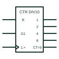

# IEC decade counter (CTR DIV10)

IEC counter marked CTR DIV10, counting through ten states with BCD-weighted outputs.

[Canonical reference](https://eloragrid.ai/symbols/iec-decade-counter) · [Structured record](../entries/iec-decade-counter.json) · [All references](README.md)

Updated: 2026-10-28. Drawing use: Schematic. Reference families: IEC, Manufacturer.

Graphical convention: IEC. Rectangular element with the CTR DIVm qualifier, m = 10.

## What it represents

CTR DIVm identifies a counter whose cycle length is m. A decade counter is therefore CTR DIV10, with outputs weighted 1, 2, 4 and 8 for a BCD count from 0 to 9. The carry output is often marked CT=9 to show it is active at the last state.
Decade counters drive numeric displays through BCD-to-seven-segment decoders and form decimal dividers in timing circuits. A drafter cascading stages should show the CT=9 carry feeding the enable of the next decade.
This differs from a decoded one-of-ten counter, which provides ten separate outputs rather than a BCD code. Check the outputs before assuming either form.

## How to read it

- DIV10 states a cycle of ten.
- CT=9 marks the carry used to cascade decades.

## Drawing checklist

- Use CTR DIV10 rather than CTR4 for BCD counters.
- Show BCD output weights.
- Show cascading between decades.

## Important distinction

The decoded decade counter has ten one-hot outputs rather than BCD-weighted outputs.

## Facts

- Qualifier: CTR DIV10
- Outputs: BCD weights 1, 2, 4, 8
- Artwork scope: Original educational illustration; consult the applicable standard and the selected device documentation for the exact graphic

## Public references

- [Overview of IEEE Standard 91-1984: explanation of logic symbols (SDYZ001A)](https://www.ti.com/lit/ml/sdyz001a/sdyz001a.pdf) — Texas Instruments. Defines CTR DIVm and contents outputs such as CT=9.

## Related references

- [Decoded decade counter](one-hot-decade-counter.md)
- [IEC BCD-to-seven-segment decoder](iec-bcd-to-seven-segment-decoder.md)
- [IEC synchronous binary counter (CTRm)](iec-synchronous-binary-counter.md)

Original educational concept geometry, CC BY 4.0. Unitless; not a certified standards glyph or manufacturer footprint.

Elora-authored explanations are CC BY 4.0. Linked standards and manufacturer material retain their own rights. Confirm project requirements using primary sources.
