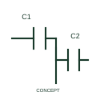

# Differential capacitor

This representation distinguishes a differential capacitive arrangement with related variable capacitances.

[Canonical reference](https://eloragrid.ai/symbols/iec-differential-capacitor) · [Structured record](../entries/iec-differential-capacitor.json) · [All references](README.md)

Updated: 2026-10-27. Drawing use: Schematic. Reference families: IEC, Manufacturer.

Graphical convention: IEC. Differential capacitor.

## What it represents

This representation distinguishes a differential capacitive arrangement with related variable capacitances. Related capacitor sections change in a coordinated differential arrangement. The common and section terminals therefore matter to interpreting the complete circuit.
Show those electrodes and the adjustment relationship in the detailed schematic. A single capacitance value or a two-terminal capacitor representation can hide the additional circuit interface.

## How to read it

- Identify the electrode/common connections and the intended adjustment relationship.
- A differential capacitor is not a generic two-terminal fixed capacitor.

## Drawing checklist

- Identify the associated device, circuit or diagram boundary.
- Identify the electrode/common connections and the intended adjustment relationship.
- Cross-reference the equipment data, terminal mapping or operating-state legend needed to interpret the form.

## Important distinction

A differential capacitor is not a generic two-terminal fixed capacitor.

## Facts

- Reference scope: Specific public IEC-context family form
- Publisher reference token: HCA1\_S00573 (Autodesk token; not a verified IEC database ID)
- Information added: Identify the electrode/common connections and the intended adjustment relationship.
- Preview: Independent educational concept; consult the publisher and applicable standard for the exact graphic

## Public references

- [Capacitive component symbols](https://help.autodesk.com/cloudhelp/2021/ENU/AutoCAD-Electrical/files/GUID-74580D46-0731-41A6-918D-2DB419114207.htm) — Autodesk. Official public publisher family name and reference context; vendor identifiers and graphics are distinct from licensed IEC database content.

## Related references

- [Resistor](resistor.md)
- [Capacitor](capacitor.md)

Original educational concept geometry, CC BY 4.0. Unitless; not a certified standards glyph or manufacturer footprint.

Elora-authored explanations are CC BY 4.0. Linked standards and manufacturer material retain their own rights. Confirm project requirements using primary sources.
