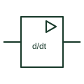

# IEC differentiator element (d/dt)

Analogue element marked d/dt whose output is proportional to the rate of change of its input.

[Canonical reference](https://eloragrid.ai/symbols/iec-differentiator) · [Structured record](../entries/iec-differentiator.json) · [All references](README.md)

Updated: 2026-10-28. Drawing use: Schematic. Reference families: IEC, Manufacturer.

Graphical convention: IEC. Rectangular analogue element with d/dt function.

## What it represents

The differentiator element carries the d/dt function. Its output is proportional to how fast the input changes, so a ramp input gives a constant output and a step input gives a spike. In circuit form it is usually an op-amp with an input capacitor and feedback resistor, often with extra components to limit high-frequency gain.
Rate-of-change functions appear in derivative control terms, df/dt style supervision and edge detection on analogue signals. The drawing should state the time constant and any filtering, because pure differentiation amplifies noise.
The element does not show the noise-limiting network. Reviewers should check that the implementing circuit or software includes one.

## How to read it

- Noise sensitivity makes filtering essential.
- Check the time constant and limiting components.

## Drawing checklist

- State the time constant.
- Show or reference high-frequency limiting.
- Reference the implementing circuit or function block.

## Important distinction

The integrator accumulates the input; the differentiator responds to its rate of change.

## Facts

- Function: Rate of change of input
- Practical caution: Amplifies high-frequency noise
- Artwork scope: Original educational illustration; consult the applicable standard and the selected device documentation for the exact graphic

## Public references

- [IEC graphical symbols for diagrams](https://tc3.iec.ch/tc-activity/graphical-symbols-for-diagrams/) — IEC. IEC graphical symbols programme covering analogue elements; no geometry reproduced.
- [Differentiator circuit reference, SBOA276](https://www.ti.com/lit/pdf/sboa276) — Texas Instruments. Manufacturer differentiator circuit documentation.

## Related references

- [Op-amp differentiator](op-amp-differentiator.md)
- [IEC integrator element (∫)](iec-integrator.md)
- [Active high-pass filter](active-high-pass-filter.md)

Original educational concept geometry, CC BY 4.0. Unitless; not a certified standards glyph or manufacturer footprint.

Elora-authored explanations are CC BY 4.0. Linked standards and manufacturer material retain their own rights. Confirm project requirements using primary sources.
