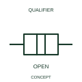

# Disconnected mechanical coupling

This indication identifies the disconnected state of a mechanical coupling.

[Canonical reference](https://eloragrid.ai/symbols/iec-disconnected-mechanical-coupling) · [Structured record](../entries/iec-disconnected-mechanical-coupling.json) · [All references](README.md)

Updated: 2026-10-27. Drawing use: Schematic. Reference families: IEC, Manufacturer.

Graphical convention: IEC. Disconnected mechanical coupling.

## What it represents

This indication identifies the disconnected state of a mechanical coupling. The driving and driven elements are represented without an engaged torque or motion-transmission relationship in this state. Either element can still have electrical connections.
Use the state diagram or mechanism schedule to define what causes engagement. The disconnected coupling mark should not be substituted for a power isolation symbol.

## How to read it

- Read the state within the documented mechanism sequence.
- A disconnected coupling state is separate from the isolation of an electrical supply.

## Drawing checklist

- Identify the associated device, circuit or diagram boundary.
- Read the state within the documented mechanism sequence.
- Cross-reference the equipment data, terminal mapping or operating-state legend needed to interpret the form.

## Important distinction

A disconnected coupling state is separate from the isolation of an electrical supply.

## Facts

- Reference scope: Specific public IEC-context family form
- Publisher reference token: Q021217 (Autodesk token; not a verified IEC database ID)
- Information added: Read the state within the documented mechanism sequence.
- Preview: Independent educational concept; consult the publisher and applicable standard for the exact graphic

## Public references

- [Autodesk IEC-60617 preview: Mechanical coupling qualifiers](https://help.autodesk.com/cloudhelp/2021/ENU/AutoCAD-Electrical/files/GUID-F3E7DE9A-47D1-4C25-BBBE-6C07AA1B3033.htm) — Autodesk. Official public publisher family name and reference context; vendor identifiers and graphics are distinct from licensed IEC database content.

## Related references

- [Relay coil](relay-coil.md)
- [Normally open contact](normally-open-contact.md)

Original educational concept geometry, CC BY 4.0. Unitless; not a certified standards glyph or manufacturer footprint.

Elora-authored explanations are CC BY 4.0. Linked standards and manufacturer material retain their own rights. Confirm project requirements using primary sources.
