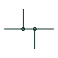

# Double junction of conductors

Four conductors joined using two offset T-junctions rather than one crossing dot, to avoid confusion with a crossing.

[Canonical reference](https://eloragrid.ai/symbols/iec-double-junction) · [Structured record](../entries/iec-double-junction.json) · [All references](README.md)

Updated: 2026-10-28. Drawing use: Schematic, SLD. Reference families: IEC.

Graphical convention: IEC. Offset double junction.

## What it represents

A four-way connection drawn as a cross with a single dot can be misread if the dot is lost in printing or scanning. The double junction draws the same connection as two T-junctions offset a short distance along the line, each with its own dot, so that the connection survives poor reproduction.
Electrically the double junction is the same node as a dotted cross. It does not represent two separate joints. Drafters use it to make the intent robust, and readers should not count it as an additional connection point or a different wire number unless the drawing shows one.

## How to read it

- Treat the two offset tees as one electrical node.
- Confirm wire numbers are the same on all four branches.

## Drawing checklist

- Use offset tees instead of dotted crosses for four-way nodes.
- Keep the offset small enough to read as one node.
- Number all four branches consistently.

## Important distinction

A double junction is one node drawn as two offset tees; an unconnected crossing has no node at all.

## Facts

- Graphic cue: Two dotted tees offset along a conductor
- Electrical meaning: One node, same as a dotted four-way cross
- Preview: Original educational illustration; consult the publisher and applicable standard for the exact graphic

## Public references

- [Wire connection dots, crossing gaps and loops](https://help.autodesk.com/cloudhelp/2020/ENU/AutoCAD-Electrical/files/GUID-936BB8A9-9C01-4AC6-B833-CB97700A7203.htm) — Autodesk. Public guidance on connection dots and crossing display.
- [IEC-60617 symbol preview directory](https://help.autodesk.com/cloudhelp/2021/ENU/AutoCAD-Electrical/files/GUID-7871E6EF-24D5-467E-9B74-321FEDC9DFDA.htm) — Autodesk. Public directory of IEC-oriented symbol families.

## Related references

- [Conductor connection junction](iec-conductor-connection-junction.md)
- [Unconnected conductor crossing](iec-unconnected-conductor-crossing.md)
- [T-connection without junction dot](iec-t-connection-without-dot.md)

Original educational concept geometry, CC BY 4.0. Unitless; not a certified standards glyph or manufacturer footprint.

Elora-authored explanations are CC BY 4.0. Linked standards and manufacturer material retain their own rights. Confirm project requirements using primary sources.
