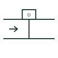

# Duct smoke detector plan symbol

Plan symbol for a smoke detector sampling air from a ventilation duct, drawn on the duct with sampling tube.

[Canonical reference](https://eloragrid.ai/symbols/iec-duct-smoke-detector-plan-symbol) · [Structured record](../entries/iec-duct-smoke-detector-plan-symbol.json) · [All references](README.md)

Updated: 2026-10-28. Drawing use: GA. Reference families: IEC.

Graphical convention: IEC. Duct smoke detector.

## What it represents

Duct smoke detectors sample air flowing in a ventilation duct through a sampling tube, so smoke can be detected and air handling shut down or dampers closed. Plans draw the detector housing on the duct with a line across the duct for the sampling tube.
They are coordinated with mechanical drawings and with the fire alarm cause and effect, since their main job is usually plant control. A remote indicator is often required where the detector is in a ceiling void.
The symbol does not prove the detector provides room protection. Duct detectors are not a substitute for area detection.

## How to read it

- Check the duct and airflow direction on mechanical drawings.
- Look for a remote indicator.

## Drawing checklist

- Show duct location.
- Define plant shutdown action.
- Provide remote indicator.

## Important distinction

A room smoke detector protects a space; a duct detector monitors air in a duct for plant control.

## Facts

- Primary purpose: Shut down air handling or close dampers
- Companion: Remote indicator
- Exact standard graphic: Not reproduced here; confirm the form against IEC 60617 and the project legend

## Public references

- [IEC graphical symbols for diagrams](https://tc3.iec.ch/tc-activity/graphical-symbols-for-diagrams/) — IEC. IEC graphical symbol context for installation plans; independently drawn here.
- [Electrical installation design methodology and references](https://www.electrical-installation.org/enwiki/General_rules_of_electrical_installation_design) — Schneider Electric — Electrical Installation Guide. Installation design context: life-safety systems are coordinated with the building electrical design.

## Related references

- [Smoke detector plan symbol](iec-smoke-detector-plan-symbol.md)
- [Combined fire-smoke damper](ga-combined-fire-smoke-damper.md)

Original educational concept geometry, CC BY 4.0. Unitless; not a certified standards glyph or manufacturer footprint.

Elora-authored explanations are CC BY 4.0. Linked standards and manufacturer material retain their own rights. Confirm project requirements using primary sources.
