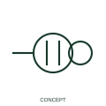

# Duplex power receptacle

This form distinguishes a duplex receptacle arrangement.

[Canonical reference](https://eloragrid.ai/symbols/iec-duplex-power-receptacle) · [Structured record](../entries/iec-duplex-power-receptacle.json) · [All references](README.md)

Updated: 2026-10-27. Drawing use: Schematic. Reference families: IEC, Manufacturer.

Graphical convention: IEC. Duplex power receptacle.

## What it represents

This form distinguishes a duplex receptacle arrangement.
Document circuit connections and the actual device configuration rather than relying on the paired appearance.
A duplex indication does not establish independent supplies or a particular regional socket standard.

## How to read it

- Document circuit connections and the actual device configuration rather than relying on the paired appearance.
- A duplex indication does not establish independent supplies or a particular regional socket standard.

## Drawing checklist

- Identify the associated device, circuit or diagram boundary.
- Document circuit connections and the actual device configuration rather than relying on the paired appearance.
- Cross-reference the equipment data, terminal mapping or operating-state legend needed to interpret the form.

## Important distinction

A duplex indication does not establish independent supplies or a particular regional socket standard.

## Facts

- Reference scope: Specific public IEC-context family form
- Publisher reference token: HCN1RDUP (Autodesk token; not a verified IEC database ID)
- Information added: Document circuit connections and the actual device configuration rather than relying on the paired appearance.
- Preview: Independent educational concept; consult the publisher and applicable standard for the exact graphic

## Public references

- [Autodesk IEC-60617 preview: Single and duplex power-receptacle forms](https://help.autodesk.com/cloudhelp/2021/ENU/AutoCAD-Electrical/files/GUID-7DAEDB03-74FC-47A2-9C50-9164297AA5A3.htm) — Autodesk. Official public publisher family name and reference context; vendor identifiers and graphics are distinct from licensed IEC database content.

## Related references

- [Power converter / inverter](power-converter.md)
- [Generic electrical load](generic-electrical-load.md)

Original educational concept geometry, CC BY 4.0. Unitless; not a certified standards glyph or manufacturer footprint.

Elora-authored explanations are CC BY 4.0. Linked standards and manufacturer material retain their own rights. Confirm project requirements using primary sources.
