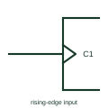

# IEC dynamic input (edge-triggered)

Wedge drawn inside the outline at an input, meaning the input acts on a transition rather than a level.

[Canonical reference](https://eloragrid.ai/symbols/iec-dynamic-input) · [Structured record](../entries/iec-dynamic-input.json) · [All references](README.md)

Updated: 2026-10-28. Drawing use: Schematic. Reference families: IEC, Manufacturer.

Graphical convention: IEC. Small wedge inside the outline at the input.

## What it represents

The dynamic input indicator is a small wedge inside the outline at the point where the input line enters. It means the input is active only on a transition, normally from external 0 to 1 in positive logic. It is the mark that distinguishes an edge-triggered flip-flop clock from a level-sensitive latch enable.
On sequential logic drawings the reader should look for the wedge at every C input. A missing wedge on a clock input changes the device from edge-triggered to transparent, which changes timing behaviour significantly.
The wedge does not specify setup or hold time, nor maximum clock rate. Those are device timing parameters. Check the active clock edge against the input waveform and the timing data of the actual logic element.

## How to read it

- Wedge present: edge-triggered; wedge absent: level-sensitive.
- Check for a negation or polarity mark that reverses the active edge.

## Drawing checklist

- Draw the wedge inside the outline at the clock input.
- Show negation outside the outline for falling-edge inputs.
- Label the input with its dependency number, for example C1.

## Important distinction

The postponed-output mark relates to pulse-triggered elements whose output changes at the end of the pulse, not at the edge.

## Facts

- Meaning: Active on a transition
- Typical label: C1 on a clock input
- Artwork scope: Original educational illustration; consult the applicable standard and the selected device documentation for the exact graphic

## Public references

- [Overview of IEEE Standard 91-1984: explanation of logic symbols (SDYZ001A)](https://www.ti.com/lit/ml/sdyz001a/sdyz001a.pdf) — Texas Instruments. Dynamic input indication in positive logic, negative logic and polarity notation.
- [SN74HC74 — positive-edge D flip-flops](https://www.ti.com/lit/ds/symlink/sn74hc74.pdf) — Texas Instruments. Edge-triggered flip-flop documentation.

## Related references

- [IEC dynamic input with negation (falling edge)](iec-falling-edge-dynamic-input.md)
- [IEC D flip-flop (rectangular form)](iec-d-flip-flop.md)
- [Positive-edge D flip-flop](positive-edge-d-flip-flop.md)

Original educational concept geometry, CC BY 4.0. Unitless; not a certified standards glyph or manufacturer footprint.

Elora-authored explanations are CC BY 4.0. Linked standards and manufacturer material retain their own rights. Confirm project requirements using primary sources.
