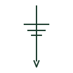

# Earth electrode

A conductor in contact with the ground, such as a driven rod, providing the installation's connection to earth.

[Canonical reference](https://eloragrid.ai/symbols/iec-earth-electrode) · [Structured record](../entries/iec-earth-electrode.json) · [All references](README.md)

Updated: 2026-10-28. Drawing use: SLD, GA. Reference families: IEC.

Graphical convention: IEC. Earth electrode.

## What it represents

The earth electrode symbol marks a rod, plate, tape or foundation electrode that makes contact with the general mass of the earth. It appears on earthing diagrams and site layouts, often numbered so that individual electrodes can be tested and recorded.
The symbol does not tell you the electrode resistance, length, material or depth. Those come from the earthing design and test records. Multiple electrodes drawn together are only effective if spaced appropriately; electrodes too close together share the same soil and add less than expected.

## How to read it

- Read electrode numbering for test records.
- Check spacing between multiple electrodes.

## Drawing checklist

- Number each electrode.
- State type, length and material.
- Show the test link location.

## Important distinction

An earth electrode is the physical contact with soil; an earth connection symbol is any connection to the earthing system.

## Facts

- Graphic cue: Earth symbol on a vertical rod line
- Does not show: Resistance, length or material
- Preview: Original educational illustration; consult the publisher and applicable standard for the exact graphic

## Public references

- [Earthing connections](https://www.electrical-installation.org/enwiki/Earthing_connections) — Schneider Electric, Electrical Installation Guide. Public installation-guide definition of earth electrode.
- [AutoCAD Electrical: Earthing, sources and surge protection](https://help.autodesk.com/cloudhelp/2021/ENU/AutoCAD-Electrical/files/GUID-1E3FDEAE-B4B2-417C-8075-108AA2C6E509.htm) — Autodesk. Public IEC-oriented earth forms.

## Related references

- [Removable earth test link](iec-removable-earth-test-link.md)
- [Earth grid conductor](earth-grid-conductor.md)
- [Earth connection](earth-connection.md)

Original educational concept geometry, CC BY 4.0. Unitless; not a certified standards glyph or manufacturer footprint.

Elora-authored explanations are CC BY 4.0. Linked standards and manufacturer material retain their own rights. Confirm project requirements using primary sources.
