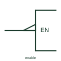

# IEC enable input (EN)

Input labelled EN that enables all outputs of the element when at its internal 1 state.

[Canonical reference](https://eloragrid.ai/symbols/iec-enable-input) · [Structured record](../entries/iec-enable-input.json) · [All references](README.md)

Updated: 2026-10-28. Drawing use: Schematic. Reference families: IEC, Manufacturer.

Graphical convention: IEC. Input labelled EN inside the outline.

## What it represents

An input labelled EN inside the outline enables every external output of the element. At its internal 0 state, open-circuit outputs are off, three-state outputs go to high impedance and other outputs take their internal 0 state. It has no effect on inputs, according to TI's public summary of the notation.
When an enable affects only some outputs, the notation changes to EN dependency with a number, for example EN1 with affected outputs labelled 1. Readers should distinguish a plain EN from ENm because the scope is different.
The label does not show the timing needed between enable and valid output. Enable and disable times are device data. Check the enabled and disabled output conditions in the selected device truth table before connecting a shared bus.

## How to read it

- A plain EN affects all outputs; ENm affects only outputs labelled m.
- Check for an external polarity mark on the EN input.

## Drawing checklist

- Write EN inside the outline at the input.
- Use ENm where scope is limited.
- Show the source of the enable signal.

## Important distinction

A C (control) input permits action of affected inputs; EN acts on outputs.

## Facts

- Scope: All outputs of the element
- Effect at internal 0: Three-state outputs high impedance
- Artwork scope: Original educational illustration; consult the applicable standard and the selected device documentation for the exact graphic

## Public references

- [Overview of IEEE Standard 91-1984: explanation of logic symbols (SDYZ001A)](https://www.ti.com/lit/ml/sdyz001a/sdyz001a.pdf) — Texas Instruments. Describes the EN input and its effect on different output types.

## Related references

- [IEC three-state output qualifier](iec-three-state-output-qualifier.md)
- [IEC control dependency (C)](iec-control-dependency-c.md)
- [IEC three-state buffer (rectangular form)](iec-three-state-buffer.md)

Original educational concept geometry, CC BY 4.0. Unitless; not a certified standards glyph or manufacturer footprint.

Elora-authored explanations are CC BY 4.0. Linked standards and manufacturer material retain their own rights. Confirm project requirements using primary sources.
