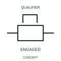

# Engaged mechanical coupling

This indication identifies engagement between the represented mechanical elements.

[Canonical reference](https://eloragrid.ai/symbols/iec-engaged-mechanical-coupling) · [Structured record](../entries/iec-engaged-mechanical-coupling.json) · [All references](README.md)

Updated: 2026-10-27. Drawing use: Schematic. Reference families: IEC, Manufacturer.

Graphical convention: IEC. Engaged mechanical coupling.

## What it represents

This indication identifies engagement between the represented mechanical elements. The represented elements share the documented motion-transmission relationship in the engaged state. That state says nothing by itself about supply energisation or electrical contact position.
Show the driving/driven device identities and connect the engagement state to its actual feedback if used. Alternate publisher graphical forms are retained within this one concept.

## How to read it

- Document the elements coupled and the applicable state condition.
- Different published graphical forms for the same engagement are kept in one concept record.

## Drawing checklist

- Identify the associated device, circuit or diagram boundary.
- Document the elements coupled and the applicable state condition.
- Cross-reference the equipment data, terminal mapping or operating-state legend needed to interpret the form.

## Important distinction

Different published graphical forms for the same engagement are kept in one concept record.

## Facts

- Reference scope: Specific public IEC-context family form
- Publisher reference token: Q021218, Q021219 (Autodesk token; not a verified IEC database ID)
- Information added: Document the elements coupled and the applicable state condition.
- Preview: Independent educational concept; consult the publisher and applicable standard for the exact graphic

## Public references

- [Autodesk IEC-60617 preview: Mechanical coupling qualifiers](https://help.autodesk.com/cloudhelp/2021/ENU/AutoCAD-Electrical/files/GUID-F3E7DE9A-47D1-4C25-BBBE-6C07AA1B3033.htm) — Autodesk. Official public publisher family name and reference context; vendor identifiers and graphics are distinct from licensed IEC database content.

## Related references

- [Relay coil](relay-coil.md)
- [Normally open contact](normally-open-contact.md)

Original educational concept geometry, CC BY 4.0. Unitless; not a certified standards glyph or manufacturer footprint.

Elora-authored explanations are CC BY 4.0. Linked standards and manufacturer material retain their own rights. Confirm project requirements using primary sources.
