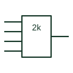

# IEC even-parity element

Element marked 2k whose output is active when an even number of its inputs are active.

[Canonical reference](https://eloragrid.ai/symbols/iec-even-parity-element) · [Structured record](../entries/iec-even-parity-element.json) · [All references](README.md)

Updated: 2026-10-28. Drawing use: Schematic. Reference families: IEC, Manufacturer.

Graphical convention: IEC. Rectangular element with the 2k general qualifier.

## What it represents

The 2k qualifier means the output is active when an even number of inputs, including none, are active. It is the multi-input generalisation of exclusive-NOR and is used in parity generation and checking for data words.
On communication or memory logic drawings the even-parity element may feed a parity bit or compare a received parity bit. The drawing should indicate how many inputs are grouped, often with an input-line grouping or a bus notation, because the function depends on the full set.
The element gives no information about word framing or when the parity result is sampled. Clocking and latching are separate elements.

## How to read it

- Count all inputs, including any shown by bus notation.
- Zero active inputs counts as even.

## Drawing checklist

- Use 2k rather than =1 or = for parity.
- Group the input bus clearly.
- Show where the result is latched or compared.

## Important distinction

The 2k+1 element is its complement and gives odd parity.

## Facts

- Qualifier: 2k (even number active)
- Two-input equivalent: Exclusive-NOR
- Artwork scope: Original educational illustration; consult the applicable standard and the selected device documentation for the exact graphic

## Public references

- [Overview of IEEE Standard 91-1984: explanation of logic symbols (SDYZ001A)](https://www.ti.com/lit/ml/sdyz001a/sdyz001a.pdf) — Texas Instruments. Defines the 2k qualifier.
- [SN74LS280 — odd/even parity generation and checking](https://www.ti.com/product/SN74LS280) — Texas Instruments. Manufacturer parity generator and checker documentation.

## Related references

- [IEC odd-parity element](iec-odd-parity-element.md)
- [Parity generator / checker](parity-generator-checker.md)
- [IEC logic identity element](iec-logic-identity-element.md)

Original educational concept geometry, CC BY 4.0. Unitless; not a certified standards glyph or manufacturer footprint.

Elora-authored explanations are CC BY 4.0. Linked standards and manufacturer material retain their own rights. Confirm project requirements using primary sources.
