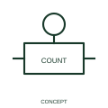

# Event-count actuation qualifier

This qualifier identifies operation related to a count of events.

[Canonical reference](https://eloragrid.ai/symbols/iec-event-count-actuation-qualifier) · [Structured record](../entries/iec-event-count-actuation-qualifier.json) · [All references](README.md)

Updated: 2026-10-27. Drawing use: Schematic. Reference families: IEC, Manufacturer.

Graphical convention: IEC. Event-count actuation qualifier.

## What it represents

This qualifier identifies operation related to a count of events. A counted event can be an incoming pulse, an operating cycle or another defined occurrence. The threshold operates on the count, not simply on the passage of time.
Identify the count source and the reset relationship alongside the associated device. This makes the difference between a counter-triggered action and a timer-triggered action visible to a reviewer.

## How to read it

- Identify what is counted and how the operating or reset condition is documented.
- Event counting differs from elapsed-time operation.

## Drawing checklist

- Identify the associated device, circuit or diagram boundary.
- Identify what is counted and how the operating or reset condition is documented.
- Cross-reference the equipment data, terminal mapping or operating-state legend needed to interpret the form.

## Important distinction

Event counting differs from elapsed-time operation.

## Facts

- Reference scope: Specific public IEC-context family form
- Publisher reference token: Q021402 (Autodesk token; not a verified IEC database ID)
- Information added: Identify what is counted and how the operating or reset condition is documented.
- Preview: Independent educational concept; consult the publisher and applicable standard for the exact graphic

## Public references

- [Autodesk IEC-60617 preview: Operating-device and function qualifiers](https://help.autodesk.com/cloudhelp/2021/ENU/AutoCAD-Electrical/files/GUID-3598E18D-9F8A-48CE-83D0-4CEBA0AE869C.htm) — Autodesk. Official public publisher family name and reference context; vendor identifiers and graphics are distinct from licensed IEC database content.

## Related references

- [Relay coil](relay-coil.md)
- [Normally open contact](normally-open-contact.md)

Original educational concept geometry, CC BY 4.0. Unitless; not a certified standards glyph or manufacturer footprint.

Elora-authored explanations are CC BY 4.0. Linked standards and manufacturer material retain their own rights. Confirm project requirements using primary sources.
