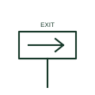

# Exit sign luminaire plan mark

Plan mark for an illuminated exit or escape route sign, with an arrow showing the direction of travel.

[Canonical reference](https://eloragrid.ai/symbols/iec-exit-sign-luminaire) · [Structured record](../entries/iec-exit-sign-luminaire.json) · [All references](README.md)

Updated: 2026-10-28. Drawing use: GA. Reference families: IEC.

Graphical convention: IEC. Exit sign luminaire.

## What it represents

Exit signs are drawn as a rectangle or luminaire mark with an arrow or EXIT text and, where relevant, the direction arrow that will appear on the sign face. Their position is set by the escape route design and they are usually maintained emergency luminaires.
The plan should show mounting (ceiling-hung, wall or projecting), whether single- or double-sided, and the arrow direction. Errors in arrow direction are a common defect found at inspection. The symbol does not give the viewing distance or legend type. Local regulations determine pictogram style.

## How to read it

- Check arrow direction matches the escape route.
- Check single- or double-sided faces.

## Drawing checklist

- Specify faces and arrows.
- State viewing distance class.
- Confirm maintained operation.

## Important distinction

An emergency luminaire lights the escape route; an exit sign identifies the route and direction.

## Facts

- Graphic cue: Rectangle with direction arrow
- Common operation: Maintained
- Exact standard graphic: Not reproduced here; confirm the form against IEC 60617 and the project legend

## Public references

- [IEC graphical symbols for diagrams](https://tc3.iec.ch/tc-activity/graphical-symbols-for-diagrams/) — IEC. IEC graphical symbol context for installation plans; independently drawn here.
- [Electrical installation design methodology and references](https://www.electrical-installation.org/enwiki/General_rules_of_electrical_installation_design) — Schneider Electric — Electrical Installation Guide. Installation design methodology covering lighting circuits and final distribution.

## Related references

- [Maintained emergency luminaire plan mark](iec-maintained-emergency-luminaire.md)
- [ANSI exit light outlet plan symbol](ansi-exit-light-outlet.md)

Original educational concept geometry, CC BY 4.0. Unitless; not a certified standards glyph or manufacturer footprint.

Elora-authored explanations are CC BY 4.0. Linked standards and manufacturer material retain their own rights. Confirm project requirements using primary sources.
