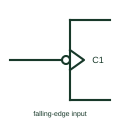

# IEC dynamic input with negation (falling edge)

Clock wedge combined with a negation circle or polarity triangle, so the input acts on a falling edge.

[Canonical reference](https://eloragrid.ai/symbols/iec-falling-edge-dynamic-input) · [Structured record](../entries/iec-falling-edge-dynamic-input.json) · [All references](README.md)

Updated: 2026-10-28. Drawing use: Schematic. Reference families: IEC, Manufacturer.

Graphical convention: IEC. Wedge inside the outline combined with an external negation circle or polarity triangle.

## What it represents

Combining the dynamic input wedge with input negation, or with a polarity indicator, means the input is active on the transition from high to low. TI's public overview tabulates how the active transition reads in positive logic, negative logic and polarity notation.
Negative-edge clocking appears in JK flip-flops and some counters, and in designs where two stages are clocked on opposite edges. A reader must check both the wedge and the external mark before deciding which edge the device responds to.
The symbol does not state duty-cycle or minimum pulse width requirements; those come from device timing data. The input waveform must satisfy those limits at the active falling transition, not just reach a valid steady logic level.

## How to read it

- Look outside the outline for the circle or triangle as well as inside for the wedge.
- Opposite-edge clocking between stages is often deliberate.

## Drawing checklist

- Draw both the wedge and the external negation mark.
- Keep notation consistent with the rest of the sheet.
- Annotate the clock net with its active edge if mixed edges are used.

## Important distinction

A wedge without an external mark is rising-edge triggered.

## Facts

- Meaning: Active on high-to-low transition
- Typical device: Negative-edge JK flip-flop
- Artwork scope: Original educational illustration; consult the applicable standard and the selected device documentation for the exact graphic

## Public references

- [Overview of IEEE Standard 91-1984: explanation of logic symbols (SDYZ001A)](https://www.ti.com/lit/ml/sdyz001a/sdyz001a.pdf) — Texas Instruments. Tabulates dynamic input forms for each logic convention.
- [SN74HC112 — negative-edge JK flip-flops](https://www.ti.com/lit/ds/symlink/sn74hc112.pdf) — Texas Instruments. Negative-edge JK flip-flop documentation.

## Related references

- [IEC dynamic input (edge-triggered)](iec-dynamic-input.md)
- [Negative-edge JK flip-flop](negative-edge-jk-flip-flop.md)
- [IEC JK flip-flop (rectangular form)](iec-jk-flip-flop.md)

Original educational concept geometry, CC BY 4.0. Unitless; not a certified standards glyph or manufacturer footprint.

Elora-authored explanations are CC BY 4.0. Linked standards and manufacturer material retain their own rights. Confirm project requirements using primary sources.
