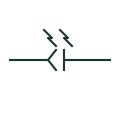

# Fibre-optic connector

A demountable joint between optical fibres, drawn as a connector on a fibre link with an optical path mark.

[Canonical reference](https://eloragrid.ai/symbols/iec-fibre-optic-connector) · [Structured record](../entries/iec-fibre-optic-connector.json) · [All references](README.md)

Updated: 2026-10-28. Drawing use: Schematic. Reference families: IEC.

Graphical convention: IEC. Optical fibre connector.

## What it represents

The fibre-optic connector shows a point where two fibres are joined by a demountable connector, such as at a patch panel or on a relay communications port. Protection signalling and process bus networks use many of them, and each one adds insertion loss to the link budget.
The symbol does not state the connector type, polish or whether it is single mode or multimode. Mismatched connectors or polish types cause high loss or reflections. Fusion splices are a different item and should not be drawn as connectors, since they cannot be disconnected.

## How to read it

- Count connectors on the link for the loss budget.
- Check connector type against the device port.

## Drawing checklist

- State connector type and polish.
- Distinguish connectors from fusion splices.
- Record connector positions in the fibre schedule.

## Important distinction

A fibre-optic connector is demountable; a fusion splice is a permanent joint.

## Facts

- Graphic cue: Connector halves on a line with an optical path mark
- Link budget: Each mated pair adds insertion loss
- Preview: Original educational illustration; consult the publisher and applicable standard for the exact graphic

## Public references

- [AutoCAD Electrical: Connectors](https://help.autodesk.com/cloudhelp/2021/ENU/AutoCAD-Electrical/files/GUID-7175D293-9F4C-485C-8E2D-DE684820D53B.htm) — Autodesk. Public IEC-oriented preview of plug and jack connector forms.
- [IEC-60617 symbol preview directory](https://help.autodesk.com/cloudhelp/2021/ENU/AutoCAD-Electrical/files/GUID-7871E6EF-24D5-467E-9B74-321FEDC9DFDA.htm) — Autodesk. Public directory of IEC-oriented symbol families.

## Related references

- [Optical fibre cable](optical-fibre-cable.md)
- [Plug and socket connector pair](plug-and-socket-connector-pair.md)
- [Coaxial plug and socket](iec-coaxial-plug-and-socket.md)

Original educational concept geometry, CC BY 4.0. Unitless; not a certified standards glyph or manufacturer footprint.

Elora-authored explanations are CC BY 4.0. Linked standards and manufacturer material retain their own rights. Confirm project requirements using primary sources.
