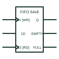

# IEC first-in first-out memory (FIFO)

IEC element marked FIFO that stores words in arrival order and reads them out in the same order.

[Canonical reference](https://eloragrid.ai/symbols/iec-fifo-memory) · [Structured record](../entries/iec-fifo-memory.json) · [All references](README.md)

Updated: 2026-10-28. Drawing use: Schematic. Reference families: IEC, Manufacturer.

Graphical convention: IEC. Rectangular element with FIFO qualifier, write and read clocks and status outputs.

## What it represents

The FIFO qualifier identifies a first-in first-out memory. There are no address inputs; instead, a write clock stores input words and a read clock delivers them in the same order. Status outputs indicate empty, full and sometimes half-full conditions.
FIFOs buffer data between parts of a system that run at different rates, such as a serial receiver and a processor. On a drawing, the status outputs should be traced to see how the system avoids overflow and underflow.
The symbol does not specify depth or whether read and write clocks can be asynchronous. The organisation and device data provide those details.

## How to read it

- No address inputs: order is implicit.
- Trace full and empty flags to their handling logic.

## Drawing checklist

- State depth and width.
- Label write and read clocks.
- Show status outputs and their use.

## Important distinction

RAM uses addresses; FIFO uses order of arrival.

## Facts

- Qualifier: FIFO
- Status outputs: Empty, full, often half-full
- Artwork scope: Original educational illustration; consult the applicable standard and the selected device documentation for the exact graphic

## Public references

- [Overview of IEEE Standard 91-1984: explanation of logic symbols (SDYZ001A)](https://www.ti.com/lit/ml/sdyz001a/sdyz001a.pdf) — Texas Instruments. Lists FIFO as a general qualifier.

## Related references

- [IEC random-access memory (RAM)](iec-random-access-memory.md)
- [IEC shift register (SRGm)](iec-shift-register.md)
- [IEC read-only memory (ROM)](iec-read-only-memory.md)

Original educational concept geometry, CC BY 4.0. Unitless; not a certified standards glyph or manufacturer footprint.

Elora-authored explanations are CC BY 4.0. Linked standards and manufacturer material retain their own rights. Confirm project requirements using primary sources.
