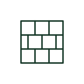

# Firewall symbol

Network symbol for a firewall, drawn as a brick wall, separating network zones on communication drawings.

[Canonical reference](https://eloragrid.ai/symbols/iec-firewall-symbol) · [Structured record](../entries/iec-firewall-symbol.json) · [All references](README.md)

Updated: 2026-10-28. Drawing use: Schematic. Reference families: IEC.

## What it represents

A firewall controls traffic between network zones according to rules, and is drawn on network diagrams as a brick wall block. Industrial drawings place it between the corporate network and control networks or between a remote access link and the plant.
Many industrial routers include firewall functions, so the drawing may show the firewall as a logical function inside a router. Where a separate appliance is used, its power and rack position appear on the electrical drawing. The symbol does not show the rule set or zones. Those belong in the cyber security documentation.

## How to read it

- Identify the zones on each side.
- Check whether it is a separate device or a router function.

## Drawing checklist

- Label zones.
- State device or function.
- Show power if a separate appliance.

## Important distinction

A router connects networks; a firewall filters traffic by policy, even when both are in one device.

## Facts

- Function: Traffic filtering between zones
- Graphic form: Brick wall block
- Preview: Independent educational concept; plan symbols for this device vary between legends, so read the project key

## Public references

- [Industrial cellular routers and gateways](https://www.westermo.com/products/routers-and-gateways/cellular-routers-and-gateways) — Westermo. Public product family page describing routers and gateways, including stateful firewall functions.

## Related references

- [Network router symbol](iec-network-router-symbol.md)
- [Industrial VPN router](ga-industrial-vpn-router.md)

Original educational concept geometry, CC BY 4.0. Unitless; not a certified standards glyph or manufacturer footprint.

Elora-authored explanations are CC BY 4.0. Linked standards and manufacturer material retain their own rights. Confirm project requirements using primary sources.
