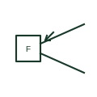

# Flame detector plan symbol

Plan symbol for a flame detector that senses ultraviolet or infrared radiation from flames, with its cone of view.

[Canonical reference](https://eloragrid.ai/symbols/iec-flame-detector-plan-symbol) · [Structured record](../entries/iec-flame-detector-plan-symbol.json) · [All references](README.md)

Updated: 2026-10-28. Drawing use: GA. Reference families: IEC.

Graphical convention: IEC. Flame detector.

## What it represents

Flame detectors sense the radiation emitted by flames, using ultraviolet, infrared or combined sensors. Plans draw the detector with radiation arrows and often the field-of-view cone so coverage can be checked against the protected hazard.
They are used for fuel stores, generator rooms, turbine enclosures and hazardous industrial areas where flaming fires are expected. Hazardous-area classification may also apply to the device, which the plan should tag. The cone drawn is approximate; sensitivity falls with distance and angle. Check the product data.

## How to read it

- Check the cone covers the hazard.
- Check hazardous-area markings.

## Drawing checklist

- Show field of view.
- State sensor type.
- State hazardous-area rating if any.

## Important distinction

A smoke detector responds to particles; a flame detector responds to radiation from the flame.

## Facts

- Sensing: Ultraviolet, infrared or both
- Coverage: Cone of view
- Exact standard graphic: Not reproduced here; confirm the form against IEC 60617 and the project legend

## Public references

- [IEC graphical symbols for diagrams](https://tc3.iec.ch/tc-activity/graphical-symbols-for-diagrams/) — IEC. IEC graphical symbol context for installation plans; independently drawn here.
- [Autodesk IEC-60617 preview: Radiation qualifiers](https://help.autodesk.com/cloudhelp/2021/ENU/AutoCAD-Electrical/files/GUID-EABC81B4-549D-49C9-A0F5-086DD204A689.htm) — Autodesk. Public IEC-oriented radiation qualifiers relevant to optical and infrared detection marks.

## Related references

- [Smoke detector plan symbol](iec-smoke-detector-plan-symbol.md)
- [Non-ionising radiation qualifier](iec-non-ionising-radiation-qualifier.md)

Original educational concept geometry, CC BY 4.0. Unitless; not a certified standards glyph or manufacturer footprint.

Elora-authored explanations are CC BY 4.0. Linked standards and manufacturer material retain their own rights. Confirm project requirements using primary sources.
