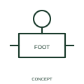

# Foot-operation qualifier

This qualifier identifies actuation by a foot-operated mechanism.

[Canonical reference](https://eloragrid.ai/symbols/iec-foot-operation-qualifier) · [Structured record](../entries/iec-foot-operation-qualifier.json) · [All references](README.md)

Updated: 2026-10-27. Drawing use: Schematic. Reference families: IEC, Manufacturer.

Graphical convention: IEC. Foot-operation qualifier.

## What it represents

This qualifier identifies actuation by a foot-operated mechanism. A foot-operated mechanism allows an operator action to be applied through a pedal or similar member. The electrical function remains in the associated switch or control contacts.
A foot operation can initiate a pulse or maintain a state, depending on the device. Show the actual return and latch behaviour so the circuit is readable without guessing from the actuator type.

## How to read it

- Link the actuation indication to its contact set and defined release behaviour.
- A foot actuator may be momentary or maintained; its return behaviour needs a separate indication.

## Drawing checklist

- Identify the associated device, circuit or diagram boundary.
- Link the actuation indication to its contact set and defined release behaviour.
- Cross-reference the equipment data, terminal mapping or operating-state legend needed to interpret the form.

## Important distinction

A foot actuator may be momentary or maintained; its return behaviour needs a separate indication.

## Facts

- Reference scope: Specific public IEC-context family form
- Publisher reference token: Q021310 (Autodesk token; not a verified IEC database ID)
- Information added: Link the actuation indication to its contact set and defined release behaviour.
- Preview: Independent educational concept; consult the publisher and applicable standard for the exact graphic

## Public references

- [Autodesk IEC-60617 preview: Operating-device and function qualifiers](https://help.autodesk.com/cloudhelp/2021/ENU/AutoCAD-Electrical/files/GUID-3598E18D-9F8A-48CE-83D0-4CEBA0AE869C.htm) — Autodesk. Official public publisher family name and reference context; vendor identifiers and graphics are distinct from licensed IEC database content.

## Related references

- [Relay coil](relay-coil.md)
- [Normally open contact](normally-open-contact.md)

Original educational concept geometry, CC BY 4.0. Unitless; not a certified standards glyph or manufacturer footprint.

Elora-authored explanations are CC BY 4.0. Linked standards and manufacturer material retain their own rights. Confirm project requirements using primary sources.
