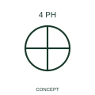

# Four-phase winding with accessible connection

This qualifier identifies a four-phase winding form with an accessible connection described by the publisher as accessible ground.

[Canonical reference](https://eloragrid.ai/symbols/iec-four-phase-winding-with-accessible-connection) · [Structured record](../entries/iec-four-phase-winding-with-accessible-connection.json) · [All references](README.md)

Updated: 2026-10-27. Drawing use: SLD, Schematic. Reference families: IEC, Manufacturer.

Graphical convention: IEC. Four-phase winding with accessible connection.

## What it represents

This qualifier identifies a four-phase winding form with an accessible connection described by the publisher as accessible ground.
Identify that connection in the actual winding and equipment diagram rather than assuming its bonding role.
An accessible common point is not automatically a protective-earth terminal.

## How to read it

- Identify that connection in the actual winding and equipment diagram rather than assuming its bonding role.
- An accessible common point is not automatically a protective-earth terminal.

## Drawing checklist

- Identify the associated device, circuit or diagram boundary.
- Identify that connection in the actual winding and equipment diagram rather than assuming its bonding role.
- Cross-reference the equipment data, terminal mapping or operating-state legend needed to interpret the form.

## Important distinction

An accessible common point is not automatically a protective-earth terminal.

## Facts

- Reference scope: Specific public IEC-context family form
- Publisher reference token: Q060203 (Autodesk token; not a verified IEC database ID)
- Information added: Identify that connection in the actual winding and equipment diagram rather than assuming its bonding role.
- Preview: Independent educational concept; consult the publisher and applicable standard for the exact graphic

## Public references

- [AutoCAD Electrical: Winding arrangements and AC/DC indications](https://help.autodesk.com/cloudhelp/2021/ENU/AutoCAD-Electrical/files/GUID-3F5A759D-872A-4990-8AAE-7CCAFBBBD4C5.htm) — Autodesk. Official public publisher family name and reference context; vendor identifiers and graphics are distinct from licensed IEC database content.

## Related references

- [Three-phase motor](motor.md)
- [Generator](generator.md)

Original educational concept geometry, CC BY 4.0. Unitless; not a certified standards glyph or manufacturer footprint.

Elora-authored explanations are CC BY 4.0. Linked standards and manufacturer material retain their own rights. Confirm project requirements using primary sources.
