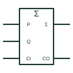

# IEC adder (Σ)

IEC element marked Σ that adds binary words P and Q with carry-in CI and carry-out CO.

[Canonical reference](https://eloragrid.ai/symbols/iec-full-adder) · [Structured record](../entries/iec-full-adder.json) · [All references](README.md)

Updated: 2026-10-28. Drawing use: Schematic. Reference families: IEC, Manufacturer.

Graphical convention: IEC. Rectangular element with Σ qualifier, P and Q inputs, CI and CO.

## What it represents

The adder qualifier is the capital sigma. Inputs are grouped into P and Q words with binary weights, plus a carry input CI; outputs give the sum with weights and a carry output CO. TI's overview lists Σ alongside P-Q for subtraction and CPG for look-ahead carry generation.
Adders on drawings usually belong to arithmetic sections of logic boards, counters with preset arithmetic, or illustrations of PLC arithmetic blocks. The carry chain between stages should be drawn so that the word length is obvious.
The symbol does not state whether the device uses ripple or look-ahead carry internally. Speed depends on that and on the word length.

## How to read it

- Check carry-in and carry-out connections between stages.
- Bit weights define the word order.

## Drawing checklist

- Mark the element with Σ.
- Label P, Q, CI and CO.
- Show the carry chain for multi-device words.

## Important distinction

A subtracter carries the P-Q qualifier instead; Σ marks an adder.

## Facts

- Qualifier: Σ
- Carry terminals: CI and CO
- Artwork scope: Original educational illustration; consult the applicable standard and the selected device documentation for the exact graphic

## Public references

- [Overview of IEEE Standard 91-1984: explanation of logic symbols (SDYZ001A)](https://www.ti.com/lit/ml/sdyz001a/sdyz001a.pdf) — Texas Instruments. Lists Σ as the adder qualifier.
- [CD74HC283 — binary full adders](https://www.ti.com/product/CD74HC283) — Texas Instruments. Binary full adder documentation.

## Related references

- [Binary full adder](binary-full-adder.md)
- [IEC arithmetic logic unit (ALU)](iec-arithmetic-logic-unit.md)
- [IEC magnitude comparator (COMP)](iec-magnitude-comparator.md)

Original educational concept geometry, CC BY 4.0. Unitless; not a certified standards glyph or manufacturer footprint.

Elora-authored explanations are CC BY 4.0. Linked standards and manufacturer material retain their own rights. Confirm project requirements using primary sources.
