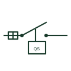

# IEC fused switching form: 1 phase disconnect with fuse

Fused switching form form: 1 Phase Disconnect with Fuse.

[Canonical reference](https://eloragrid.ai/symbols/iec-fused-switching-form-1-phase-disconnect-with-fuse) · [Structured record](../entries/iec-fused-switching-form-1-phase-disconnect-with-fuse.json) · [All references](README.md)

Updated: 2026-10-28. Drawing use: Schematic. Reference families: IEC, Manufacturer.

Graphical convention: IEC. 1 Phase Disconnect with Fuse.

## What it represents

A fused switching form identifies a switch and a fuse within the documented arrangement. Switching load current, providing isolation and interrupting a fault are separate capabilities, and the drawing must show which element performs each role. This entry identifies the 1 phase disconnect with fuse form in the publisher's IEC-context family.
An outgoing panel feeder can show a fused switch with its operating handle and fuse reference. Keep the switching tag linked to the fuse schedule so replacement protection and the intended switching duty can be checked together.
The family name does not establish a device utilization category or prove that a fuse carrier may be moved under load. Use the selected assembly documentation for load operation, isolation indication, fuse class and any interlocks.

## How to read it

- An outgoing panel feeder can show a fused switch with its operating handle and fuse reference. Keep the switching tag linked to the fuse schedule so replacement protection and the intended switching duty can be checked together.
- The family name does not establish a device utilization category or prove that a fuse carrier may be moved under load. Use the selected assembly documentation for load operation, isolation indication, fuse class and any interlocks.

## Drawing checklist

- Identify the switching element and associated fuse references.
- State whether the device switches load current and provides isolation.
- Reference fuse class, current rating and operating instructions.

## Important distinction

This entry adds the 1 phase disconnect with fuse detail to the broader fused switching form family. The family name does not establish a device utilization category or prove that a fuse carrier may be moved under load. Use the selected assembly documentation for load operation, isolation indication, fuse class and any interlocks.

## Facts

- Drawing form: 1 Phase Disconnect with Fuse
- Public vendor block names: HDS11Q81 / VDS11Q81. Autodesk identifiers, not standards database IDs.
- Drawing purpose: fused switching form
- Graphic scope: Independently authored educational illustration; not certified standard geometry, a terminal pinout or a product footprint.

## Public references

- [AutoCAD Electrical: Fusible disconnects](https://help.autodesk.com/cloudhelp/2021/ENU/AutoCAD-Electrical/files/GUID-FE7E6B30-F585-41F4-9F66-215ACD95A36D.htm) — Autodesk. Public Fusible Disconnects table explicitly lists HDS11Q81 / VDS11Q81 with this operating or connection form. Vendor graphics are linked, not copied.

## Related references

- [Disconnector](disconnector.md)
- [Switch-disconnector](switch-disconnector.md)
- [Fused switch](fused-switch.md)

Original educational concept geometry, CC BY 4.0. Unitless; not a certified standards glyph or manufacturer footprint.

Elora-authored explanations are CC BY 4.0. Linked standards and manufacturer material retain their own rights. Confirm project requirements using primary sources.
