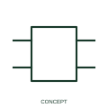

# Generic device boundary

A generic device boundary groups the terminals belonging to one documented component or function.

[Canonical reference](https://eloragrid.ai/symbols/iec-generic-device-boundary) · [Structured record](../entries/iec-generic-device-boundary.json) · [All references](README.md)

Updated: 2026-10-27. Drawing use: Schematic. Reference families: Manufacturer.

## What it represents

A generic device boundary groups the terminals belonging to one documented component or function.
Label the device role and actual terminal mapping on the boundary.
The box is a functional representation, not a cabinet footprint or certified internal circuit.

## How to read it

- Label the device role and actual terminal mapping on the boundary.
- The box is a functional representation, not a cabinet footprint or certified internal circuit.

## Drawing checklist

- Identify the associated device, circuit or diagram boundary.
- Label the device role and actual terminal mapping on the boundary.
- Cross-reference the equipment data, terminal mapping or operating-state legend needed to interpret the form.

## Important distinction

The box is a functional representation, not a cabinet footprint or certified internal circuit.

## Facts

- Reference scope: Publisher drafting annotation / connectivity convention
- Publisher reference token: HDV1T6, HDV1TC, HDV1TFL (Autodesk token; not a verified IEC database ID)
- Information added: Label the device role and actual terminal mapping on the boundary.
- Preview: Independent educational concept; consult the publisher and applicable standard for the exact graphic

## Public references

- [Autodesk IEC-60617 preview: Generic device boundary forms](https://help.autodesk.com/cloudhelp/2021/ENU/AutoCAD-Electrical/files/GUID-BF417AFE-1E1B-42BB-A39E-F75F8CB05DB8.htm) — Autodesk. Official public publisher family name and reference context; vendor identifiers and graphics are distinct from licensed IEC database content.

## Related references

- [Terminal connection](terminal.md)
- [Busbar](busbar.md)

Original educational concept geometry, CC BY 4.0. Unitless; not a certified standards glyph or manufacturer footprint.

Elora-authored explanations are CC BY 4.0. Linked standards and manufacturer material retain their own rights. Confirm project requirements using primary sources.
