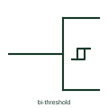

# IEC hysteresis (bi-threshold) qualifier

Small hysteresis loop mark showing a Schmitt-trigger function or a bi-threshold input.

[Canonical reference](https://eloragrid.ai/symbols/iec-hysteresis-input-qualifier) · [Structured record](../entries/iec-hysteresis-input-qualifier.json) · [All references](README.md)

Updated: 2026-10-28. Drawing use: Schematic. Reference families: IEC, Manufacturer.

Graphical convention: IEC. Hysteresis loop mark inside the outline or at an input.

## What it represents

The hysteresis mark, a small loop drawn with two offset steps, appears either as a general qualifier for a Schmitt-trigger element or next to a single input to show that input has two thresholds. TI's public overview lists both uses.
When the mark is next to one input only, the other inputs of the element have normal single thresholds. That matters on devices such as gates with one Schmitt input used to accept a slow external signal.
The mark does not quantify hysteresis. Threshold and hysteresis values must be read from device data and compared with the signal source.

## How to read it

- Check whether the mark applies to the whole element or one input.
- Compare thresholds with the signal source levels.

## Drawing checklist

- Draw the mark clearly, not as a waveform sketch.
- Place it at the input it applies to where only some inputs have hysteresis.
- Reference device thresholds.

## Important distinction

A drawn square-wave inside a G element indicates an astable, not hysteresis.

## Facts

- Meaning: Two switching thresholds
- Placement: Centre of element or at one input
- Artwork scope: Original educational illustration; consult the applicable standard and the selected device documentation for the exact graphic

## Public references

- [Overview of IEEE Standard 91-1984: explanation of logic symbols (SDYZ001A)](https://www.ti.com/lit/ml/sdyz001a/sdyz001a.pdf) — Texas Instruments. Lists the Schmitt-trigger qualifier and the bi-threshold input symbol.

## Related references

- [IEC Schmitt-trigger buffer (rectangular form)](iec-schmitt-trigger-buffer.md)
- [ANSI Schmitt-trigger NAND gate](ansi-schmitt-nand-gate.md)
- [Schmitt-trigger buffer](schmitt-trigger-buffer.md)

Original educational concept geometry, CC BY 4.0. Unitless; not a certified standards glyph or manufacturer footprint.

Elora-authored explanations are CC BY 4.0. Linked standards and manufacturer material retain their own rights. Confirm project requirements using primary sources.
