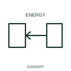

# Inbound-energy-flow qualifier

An inbound-energy qualifier identifies energy entering a represented device or system.

[Canonical reference](https://eloragrid.ai/symbols/iec-inbound-energy-flow-qualifier) · [Structured record](../entries/iec-inbound-energy-flow-qualifier.json) · [All references](README.md)

Updated: 2026-10-27. Drawing use: SLD, Schematic. Reference families: IEC, Manufacturer.

Graphical convention: IEC. Inbound-energy-flow qualifier.

## What it represents

An inbound-energy qualifier identifies energy entering a represented device or system. Energy is shown entering the represented boundary in the documented mode. The source may be the grid, a generator or another system interface.
Identify the receiving device and the source path without confusing them with the diagram’s current-reference arrows. Capacity and energy limits remain in the equipment and operating schedules.

## How to read it

- Name the receiving boundary and the energy interface.
- The qualifier does not supply a power value or establish an import/export limit.

## Drawing checklist

- Identify the associated device, circuit or diagram boundary.
- Name the receiving boundary and the energy interface.
- Cross-reference the equipment data, terminal mapping or operating-state legend needed to interpret the form.

## Important distinction

The qualifier does not supply a power value or establish an import/export limit.

## Facts

- Reference scope: Specific public IEC-context family form
- Publisher reference token: Q020507 (Autodesk token; not a verified IEC database ID)
- Information added: Name the receiving boundary and the energy interface.
- Preview: Independent educational concept; consult the publisher and applicable standard for the exact graphic

## Public references

- [Autodesk IEC-60617 preview: Energy-flow qualifiers](https://help.autodesk.com/cloudhelp/2021/ENU/AutoCAD-Electrical/files/GUID-2039C5DD-1C01-4D77-AD97-584052C53D75.htm) — Autodesk. Official public publisher family name and reference context; vendor identifiers and graphics are distinct from licensed IEC database content.

## Related references

- [Power converter / inverter](power-converter.md)
- [PLC input / output](plc-io.md)

Original educational concept geometry, CC BY 4.0. Unitless; not a certified standards glyph or manufacturer footprint.

Elora-authored explanations are CC BY 4.0. Linked standards and manufacturer material retain their own rights. Confirm project requirements using primary sources.
